# Session 14 — Kubernetes Troubleshooting & Debugging

Comprehensive hands-on lab submission for Kubernetes diagnostic commands (`kubectl get`, `describe`, `logs`, `exec`, `events`), troubleshooting pod failure states (`CrashLoopBackOff`, `ImagePullBackOff`, `Pending`), debugging Service/DNS mismatches, and resolving real-world cluster scenarios.

---

## Table of Contents

1. [Part 1 — `kubectl get`: Listing & Filtering Resources](#part-1--kubectl-get-listing--filtering-resources)
2. [Part 2 — `kubectl describe`: Deep Pod & Event Inspection](#part-2--kubectl-describe-deep-pod--event-inspection)
3. [Part 3 — `kubectl logs`: Output Stream & Tail Debugging](#part-3--kubectl-logs-output-stream--tail-debugging)
4. [Part 4 — `kubectl exec`: Interactive Container Inspection](#part-4--kubectl-exec-interactive-container-inspection)
5. [Part 5 — Kubernetes Events: Cluster-Wide Diagnostic Log](#part-5--kubernetes-events-cluster-wide-diagnostic-log)
6. [Part 6 — CrashLoopBackOff: Diagnosis & Resolution](#part-6--crashloopbackoff-diagnosis--resolution)
7. [Part 7 — ImagePullBackOff: Diagnosis & Resolution](#part-7--imagepullbackoff-diagnosis--resolution)
8. [Part 8 — Pending Pods: Unschedulable Node Selector Fix](#part-8--pending-pods-unschedulable-node-selector-fix)
9. [Part 9 — Service & DNS Troubleshooting: Endpoints & CoreDNS](#part-9--service--dns-troubleshooting-endpoints--coredns)
10. [Part 10 — Mini-Project: Real-World Scenario Resolution](#part-10--mini-project-real-world-scenario-resolution)

---

## Part 1 — `kubectl get`: Listing & Filtering Resources

### Why
`kubectl get` is the primary command to query cluster status, pod placement, IP assignments, and resource health.

### Commands Executed

```bash
cd session-14-kubernetes-troubleshooting/01-kubectl-get

# 1. Apply Pod
kubectl apply -f pod.yaml

# 2. Basic listing & Wide output (IP & Node placement)
kubectl get pods
kubectl get pods -o wide

# 3. Label selector filtering
kubectl get pods -l app=get-demo

# 4. JSON / YAML formatting
kubectl get pod get-demo -o json
```

### Expected Output
- Pod `get-demo` is `Running` with 1/1 ready.
- `-o wide` displays container IP and host node name.

### Terminal Proof / Screenshot

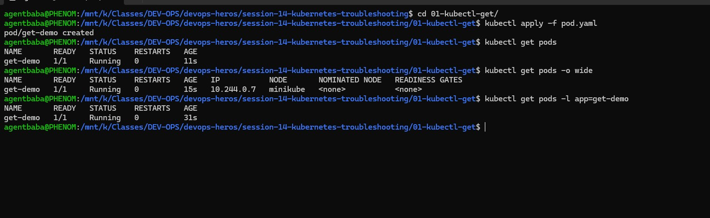

---

## Part 2 — `kubectl describe`: Deep Pod & Event Inspection

### Why
`kubectl describe` provides detailed metadata, container state, volume mounts, readiness/liveness probes, and exact Pod lifecycle event histories.

### Commands Executed

```bash
cd session-14-kubernetes-troubleshooting/02-kubectl-describe

# 1. Apply Pod
kubectl apply -f demo-pod.yaml

# 2. Inspect Pod Details
kubectl describe pod describe-demo
```

### Expected Output
- Shows container status, image name (`nginx:1.27`), state (`Running`), and Events timeline (Scheduled → Pulling → Pulled → Created → Started).

### Terminal Proof / Screenshot

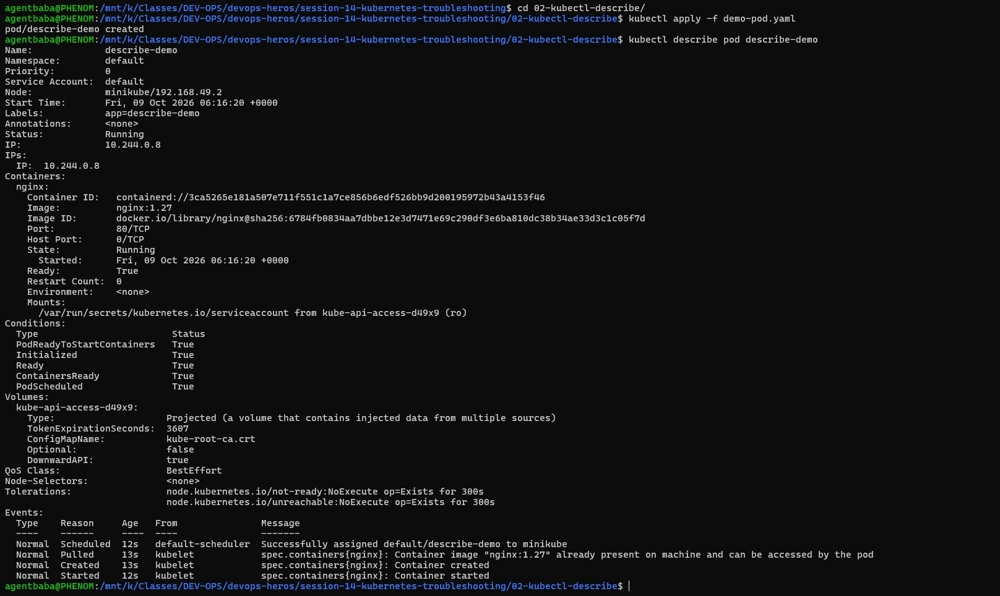

---

## Part 3 — `kubectl logs`: Output Stream & Tail Debugging

### Why
Fetches stdout and stderr output streams from container processes to debug application-level crashes, startup failures, and database connection errors.

### Commands Executed

```bash
cd session-14-kubernetes-troubleshooting/03-kubectl-logs

# 1. Apply Log Demo Pod
kubectl apply -f pod.yaml

# 2. Stream Logs
kubectl logs logs-demo

# 3. Tail live log stream
kubectl logs -f logs-demo --tail=10
```

### Expected Output
- Logs output: `"Application started"`, `"Connecting to database..."`, `"Application is healthy"`.

### Terminal Proof / Screenshot

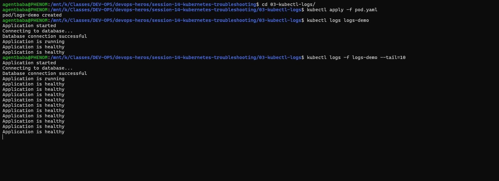

---

## Part 4 — `kubectl exec`: Interactive Container Inspection

### Why
Executes commands or opens an interactive shell session directly inside a running container to verify configuration files, environment variables, and network connectivity.

### Commands Executed

```bash
cd session-14-kubernetes-troubleshooting/04-kubectl-exec

# 1. Apply Pod
kubectl apply -f pod.yaml

# 2. Execute command inside container
kubectl exec -it exec-demo -- ls -la /usr/share/nginx/html
kubectl exec -it exec-demo -- env
```

### Expected Output
- Lists `index.html` and `50x.html` inside `/usr/share/nginx/html`.

### Terminal Proof / Screenshot

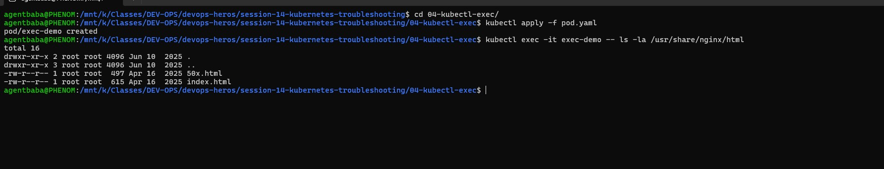

---

## Part 5 — Kubernetes Events: Cluster-Wide Diagnostic Log

### Why
Kubernetes Events record state changes, warnings, scheduling decisions, probe failures, and image pull errors across the namespace.

### Commands Executed

```bash
cd session-14-kubernetes-troubleshooting/05-events

# 1. Apply Pod
kubectl apply -f pod.yaml

# 2. View Chronological Events
kubectl get events --sort-by='.metadata.creationTimestamp'
```

### Expected Output
- Displays chronological event table highlighting pod scheduling, container creation, and startup timings.

### Terminal Proof / Screenshot

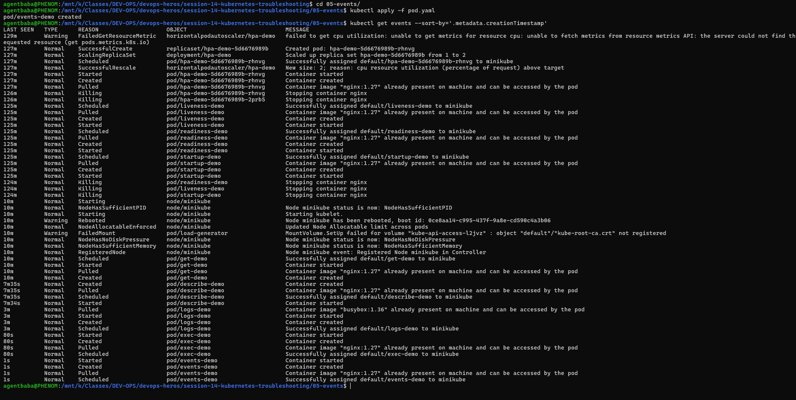

---

## Part 6 — CrashLoopBackOff: Diagnosis & Resolution

### Why
`CrashLoopBackOff` indicates that a container starts, fails/crashes (exit code != 0), and Kubernetes repeatedly restarts it with exponential backoff delays.

### Commands Executed

```bash
cd session-14-kubernetes-troubleshooting/06-crashloopbackoff

# 1. Apply Broken Pod
kubectl apply -f broken-pod.yaml

# 2. Diagnose Crash Reason
kubectl get pod crash-demo
kubectl logs crash-demo
kubectl describe pod crash-demo

# 3. Apply Fixed Pod
kubectl apply -f fixed-pod.yaml
kubectl get pod crash-demo
```

### Root Cause & Fix
- **Root Cause**: `broken-pod.yaml` executed `exit 1`.
- **Fix**: `fixed-pod.yaml` replaced command with long-running process (`sleep 3600`), transitioning status to `Running`.

### Terminal Proof / Screenshot

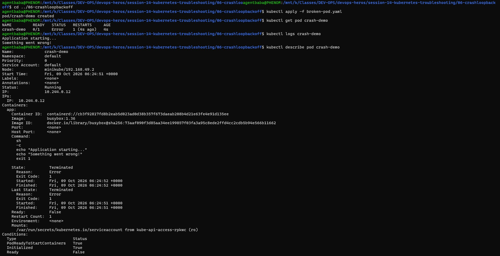
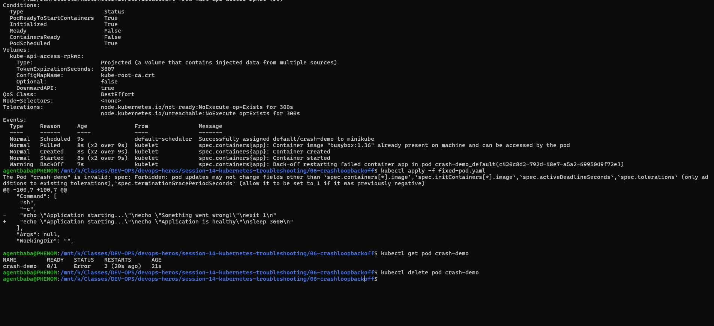

---

## Part 7 — ImagePullBackOff: Diagnosis & Resolution

### Why
`ImagePullBackOff` / `ErrImagePull` occurs when Kubelet cannot pull the specified container image (non-existent image tag, wrong registry URL, or missing pull secrets).

### Commands Executed

```bash
cd session-14-kubernetes-troubleshooting/07-imagepullbackoff

# 1. Apply Broken Image Pod
kubectl apply -f broken-pod.yaml

# 2. Diagnose Image Pull Error
kubectl get pod image-demo
kubectl describe pod image-demo

# 3. Apply Fixed Pod
kubectl apply -f fixed-pod.yaml
kubectl get pod image-demo
```

### Root Cause & Fix
- **Root Cause**: `image-demo` specified non-existent tag `nginx:this-image-does-not-exist`.
- **Fix**: Updated image tag to valid version `nginx:1.27`.

### Terminal Proof / Screenshot

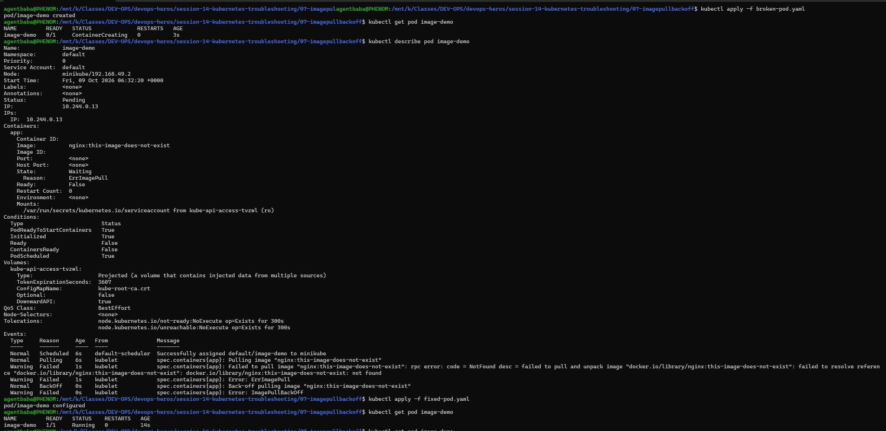

---

## Part 8 — Pending Pods: Unschedulable Node Selector Fix

### Why
A Pod remains in `Pending` state when the Kubernetes Scheduler cannot assign it to any Node (insufficient CPU/Memory resources, node selector mismatch, or missing PVC).

### Commands Executed

```bash
cd session-14-kubernetes-troubleshooting/08-pending-pods

# 1. Apply Unschedulable Pod
kubectl apply -f broken-pod.yaml

# 2. Diagnose Scheduling Failure
kubectl get pod pending-demo
kubectl describe pod pending-demo

# 3. Apply Fixed Pod
kubectl apply -f fixed-pod.yaml
kubectl get pod pending-demo
```

### Root Cause & Fix
- **Root Cause**: `nodeSelector` targeted invalid node `kubernetes.io/hostname: node-that-does-not-exist`.
- **Fix**: Removed invalid `nodeSelector`, allowing scheduler to place Pod on available node.

### Terminal Proof / Screenshot

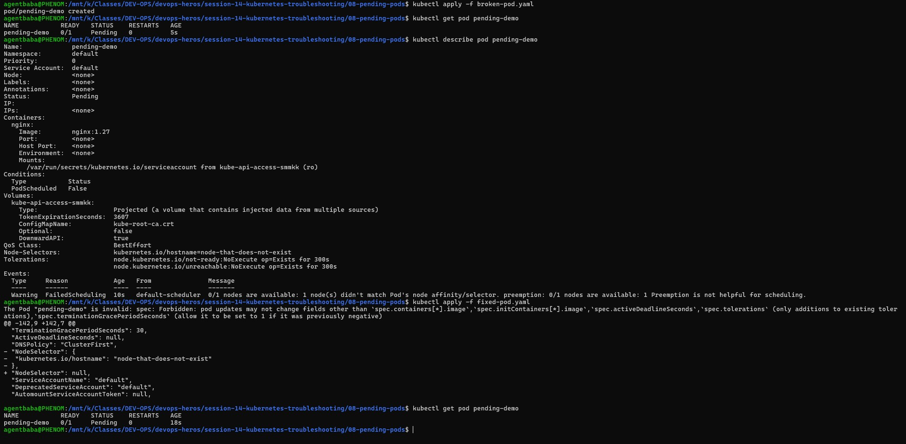

---

## Part 9 — Service & DNS Troubleshooting: Endpoints & CoreDNS

### Why
Services route traffic to Pods via matching label selectors. If selector labels don't match Pod labels, `Endpoints` remain `<none>` and HTTP/DNS requests fail.

### Commands Executed

```bash
cd session-14-kubernetes-troubleshooting/09-service-dns-troubleshooting

# 1. Apply Backend Deployment & Broken Service
kubectl apply -f deployment.yaml
kubectl apply -f broken-service.yaml

# 2. Verify Missing Endpoints (broken selector)
kubectl get service broken-service
kubectl get endpoints broken-service

# 3. Apply Service
kubectl apply -f service.yaml
kubectl get service web-service
kubectl get endpoints web-service

# 4. Verify CoreDNS Resolution via Test Pod
kubectl apply -f dns-test-pod.yaml
kubectl exec -it dns-test -- nslookup web-service
```

### Root Cause & Fix
- **Root Cause**: `broken-service` selector used `app: does-not-exist`, leaving Endpoints `<none>`.
- **Fix**: `service.yaml` deployed `web-service` to route traffic to backend Pods.

### Terminal Proof / Screenshot

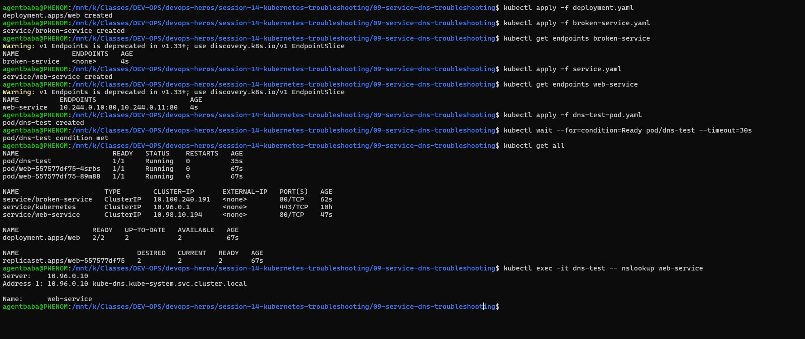

---

## Part 10 — Mini-Project: Real-World Scenario Resolution

### Why
Comprehensive debugging drill combining Pod status inspection, log analysis, event diagnosis, manifest repair, and Service endpoint verification.

### Commands Executed

```bash
cd session-14-kubernetes-troubleshooting/mini-project

# 1. Apply Broken Workload
kubectl apply -f broken-pod.yaml

# 2. Diagnose & Deploy Fixed Production Stack
kubectl describe pod project-broken-pod
kubectl apply -f deployment.yaml
kubectl apply -f service.yaml

# 3. Verify Complete Deployment Health
kubectl get all
kubectl get endpoints
```

### Terminal Proof / Screenshot

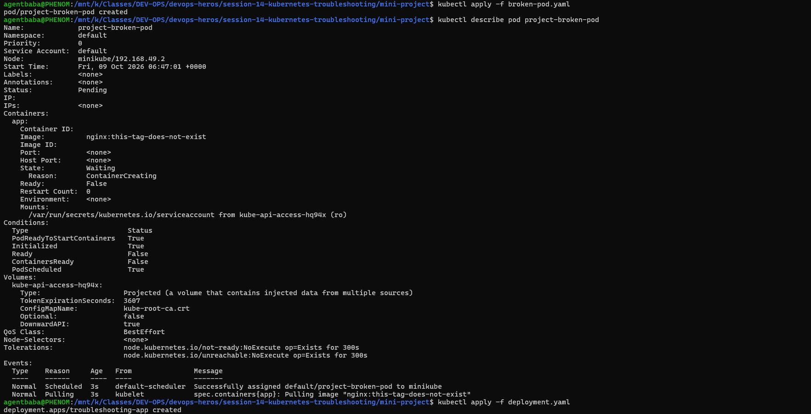
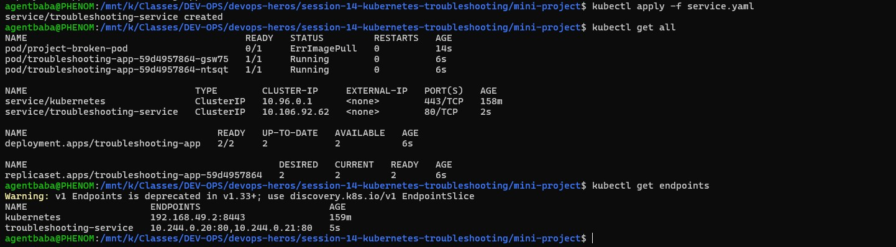

---

## Lab Cleanup

```bash
kubectl delete -f mini-project/
kubectl delete -f 09-service-dns-troubleshooting/
kubectl delete -f 08-pending-pods/
kubectl delete -f 07-imagepullbackoff/
kubectl delete -f 06-crashloopbackoff/
kubectl delete -f 05-events/
kubectl delete -f 04-kubectl-exec/
kubectl delete -f 03-kubectl-logs/
kubectl delete -f 02-kubectl-describe/
kubectl delete -f 01-kubectl-get/
```
