# Session 15: Helm — Package Management for Kubernetes

Comprehensive documentation and verification proofs for Kubernetes package management using Helm 3.

---

## Table of Contents

- [Overview](#overview)
- [Part 1 — What is Helm?](#part-1--what-is-helm)
- [Part 2 — Helm Charts](#part-2--helm-charts)
- [Part 3 — Chart Structure](#part-3--chart-structure)
- [Part 4 — Chart.yaml Configuration](#part-4--chartyaml-configuration)
- [Part 5 — values.yaml & Variable Overrides](#part-5--valuesyaml--variable-overrides)
- [Part 6 — Templates & Go Templating](#part-6--templates--go-templating)
- [Part 7 — Install, Upgrade & Release Lifecycle](#part-7--install-upgrade--release-lifecycle)
- [Part 8 — Rollback & Atomic Upgrades](#part-8--rollback--atomic-upgrades)
- [Part 9 — Deploying an Application with Helm](#part-9--deploying-an-application-with-helm)
- [Part 10 — Mini-Project: Notes App Helm Package](#part-10--mini-project-notes-app-helm-package)

---

## Overview

Managing plain Kubernetes manifests across multiple deployment environments (Dev, Staging, Production) often leads to copy-paste errors, manual drift, and complex release rollbacks. Helm solves this by functioning as the package manager for Kubernetes:
- **Chart**: A reusable, parameterized collection of Kubernetes YAML templates.
- **Values**: Environment-specific inputs injected into the chart templates at runtime.
- **Release**: A deployed, running instance of a chart inside the cluster tracked with versioned revision history.

---

## Part 1 — What is Helm?

### Why
Validates the client-only Helm 3 environment and verifies cluster connectivity without legacy server-side Tiller components.

### Commands Executed

```bash
cd session-15-helm/01-what-is-helm

# 1. Verify Helm version
helm version

# 2. Check existing releases in current namespace
helm list
```

### Expected Output
- `helm version`: Displays Client version info (e.g. `v3.x.x`).
- `helm list`: Returns an empty table header if no releases are currently deployed.

### Terminal Proof / Screenshot

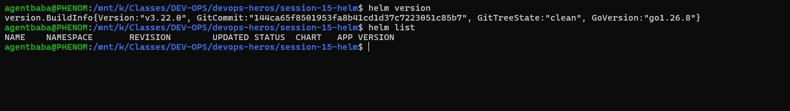

---

## Part 2 — Helm Charts

### Why
Demonstrates generating a standard chart boilerplate using `helm create` and validating template syntax with `helm lint`.

### Commands Executed

```bash
cd session-15-helm/02-helm-charts

# 1. Generate scaffold chart
helm create demo-chart

# 2. Inspect generated structure
ls -l demo-chart/

# 3. Lint chart for syntax or schema errors
helm lint demo-chart
```

### Expected Output
- Chart directory structure created (`Chart.yaml`, `values.yaml`, `charts/`, `templates/`).
- `helm lint`: Reports `1 chart(s) linted, 0 chart(s) failed`.

### Terminal Proof / Screenshot

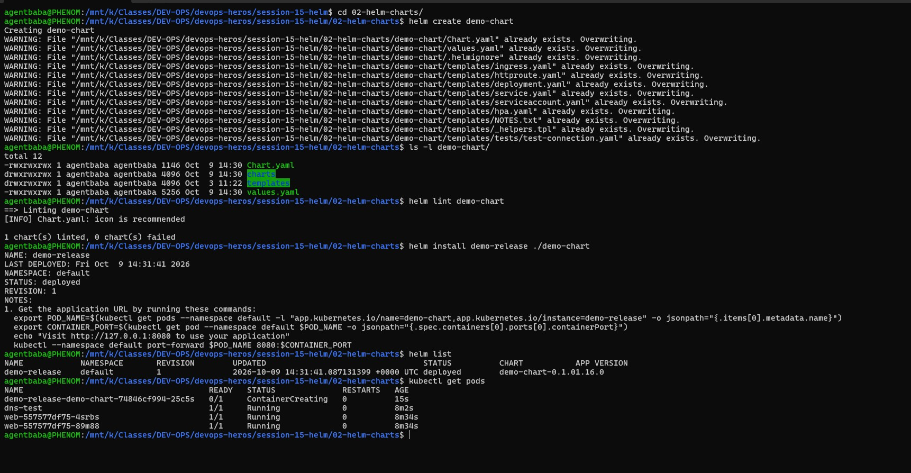

---

## Part 3 — Chart Structure

### Why
Examines the anatomy of a minimal Helm chart, demonstrating how `Chart.yaml`, `values.yaml`, and parameterized manifests in `templates/` combine.

### Commands Executed

```bash
cd session-15-helm/03-chart-structure

# 1. Inspect directory layout
tree simple-chart/

# 2. Render templates locally without contacting cluster
helm template test-release ./simple-chart
```

### Expected Output
- Directory tree display showing `Chart.yaml`, `values.yaml`, and manifests under `templates/`.
- Local template rendering outputs pure Kubernetes YAML manifests with default values populated.

### Terminal Proof / Screenshot

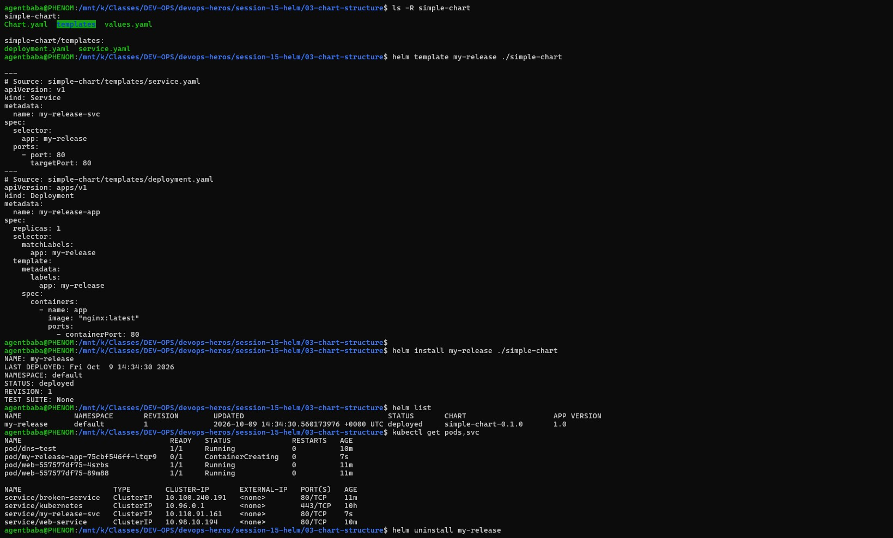

---

## Part 4 — Chart.yaml Configuration

### Why
Illustrates the distinction between semantic chart packaging (`version`) and the packaged workload image version (`appVersion`).

### Commands Executed

```bash
cd session-15-helm/04-chart-yaml

# 1. View Chart metadata
cat Chart.yaml

# 2. Validate Chart metadata schema
helm lint .
```

### Expected Output
- Clean display of `apiVersion: v2`, chart `name`, `version`, and `appVersion`.
- Schema verification passed without errors.

### Terminal Proof / Screenshot

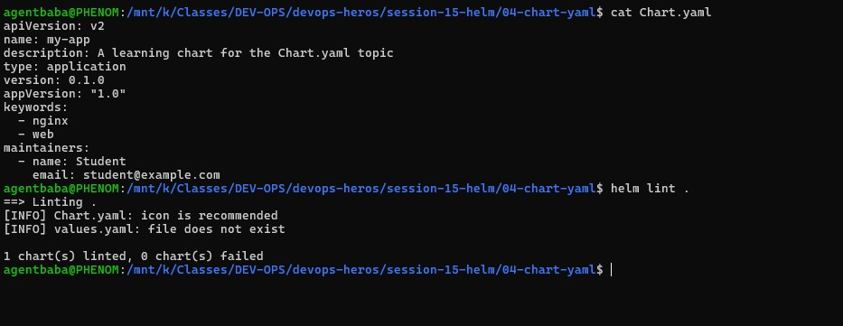

---

## Part 5 — values.yaml & Variable Overrides

### Why
Validates default values parameterization and runtime overriding via external YAML files (`-f`) and command-line flags (`--set`).

### Commands Executed

```bash
cd session-15-helm/05-values-yaml

# 1. Render default values
helm template my-release ./my-app

# 2. Render with production override values file
helm template my-release ./my-app -f values-prod.yaml

# 3. Render with command-line --set override
helm template my-release ./my-app --set replicaCount=5
```

### Expected Output
- Default rendering shows `replicaCount: 1`.
- Production values rendering reflects updated replica count and resource parameters from `values-prod.yaml`.
- `--set` override explicitly demonstrates parameter precedence.

### Terminal Proof / Screenshot

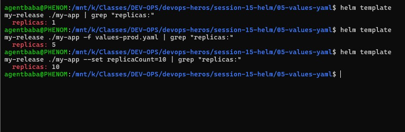

---

## Part 6 — Templates & Go Templating

### Why
Tests Helm template engine expressions, built-in release objects (`{{ .Release.Name }}`), pipeline filters (`quote`, `upper`, `default`), and conditional blocks (`if/else`).

### Commands Executed

```bash
cd session-15-helm/06-templates

# 1. Inspect Go template expressions (variables & conditionals)
cat template-demo/templates/deployment.yaml
cat template-demo/templates/service.yaml

# 2. Render dry-run template output
helm template demo ./template-demo

# 3. Test conditional logic by disabling service
helm template demo ./template-demo --set service.enabled=false
```

### Expected Output
- Valid YAML output with dynamic template variables interpolated properly into the Deployment.
- When `service.enabled=false`, the Service resource is conditionally omitted from the rendered output.

### Terminal Proof / Screenshot

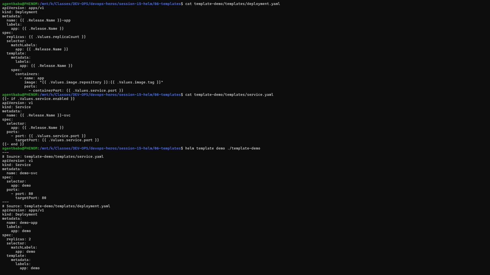
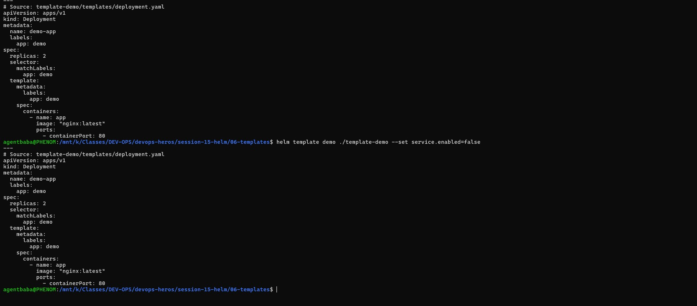

---

## Part 7 — Install, Upgrade & Release Lifecycle

### Why
Demonstrates deploying a live release into Kubernetes, performing in-place release upgrades, and auditing release revisions in the cluster.

### Commands Executed

```bash
cd session-15-helm/07-install-upgrade

# 1. Install release
helm install web-app ./app-chart

# 2. Check deployed release and pods
helm list
kubectl get pods

# 3. Upgrade release with updated replica count
helm upgrade web-app ./app-chart --set replicaCount=3

# 4. Inspect revision history
helm history web-app
kubectl get pods
```

### Expected Output
- Release status: `deployed` at `REVISION: 1`.
- Upgrade completes successfully; `REVISION: 2` created and pod replicas scale to 3.

### Terminal Proof / Screenshot

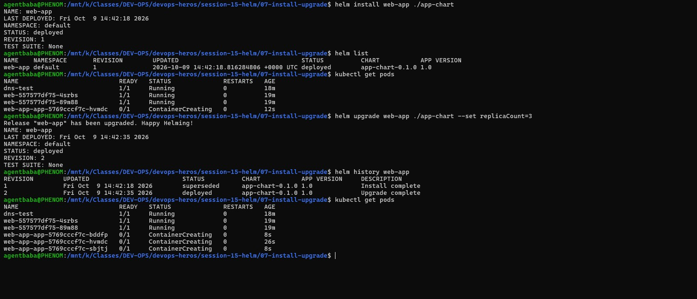

---

## Part 8 — Rollback & Atomic Upgrades

### Why
Verifies instantaneous recovery from broken deployment versions back to previous stable revisions using `helm rollback`.

### Commands Executed

```bash
cd session-15-helm/08-rollback

# 1. Upgrade to faulty image tag (triggers ImagePullBackOff)
helm upgrade app-release ../07-install-upgrade/app-chart --set image.tag=invalid-tag

# 2. Observe broken pod status
kubectl get pods

# 3. Instant rollback to stable Revision 1
helm rollback app-release 1

# 4. Verify restored healthy state
helm history app-release
kubectl get pods
```

### Expected Output
- Pod failure diagnosed (`ImagePullBackOff`).
- Rollback creates `REVISION: 4` rolled back to Revision 1 state; pods return to `Running`.

### Terminal Proof / Screenshot

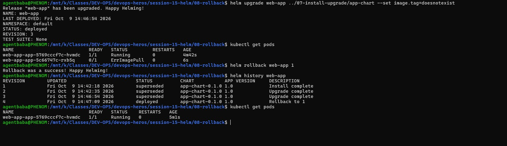

---

## Part 9 — Deploying an Application with Helm

### Why
Validates an end-to-end, multi-tier deployment (Deployment, Service, and ConfigMap) packaged and managed via a dedicated Helm chart.

### Commands Executed

```bash
cd session-15-helm/09-deploying-application

# 1. Clean previous release
helm uninstall web-app

# 2. Lint guestbook chart
helm lint ./guestbook-chart

# 3. Install guestbook release
helm install guestbook ./guestbook-chart

# 4. Verify deployed workloads & ConfigMap
kubectl get all -l app=guestbook
kubectl get configmap guestbook-config
helm list
```

### Expected Output
- Chart passes linting with 0 failures.
- Pods, ClusterIP service, and ConfigMap created and functional under release `guestbook`.

### Terminal Proof / Screenshot

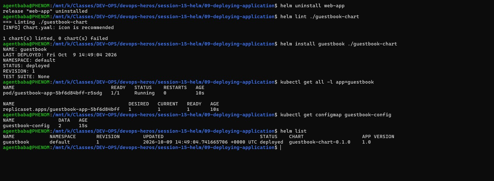

---

## Part 10 — Mini-Project: Notes App Helm Package

### Why
Capstone project demonstrating custom packaging for the Notes web application, environment-specific value overrides, NodePort exposure, and full lifecycle cleanup.

### Commands Executed

```bash
cd session-15-helm/mini-project

# 1. Clean previous release
helm uninstall guestbook

# 2. Lint custom Notes chart
helm lint ./notes-chart

# 3. Deploy development release
helm install notes-dev ./notes-chart

# 4. Upgrade release using production values override (3 replicas)
helm upgrade notes-dev ./notes-chart -f ./notes-chart/values-prod.yaml

# 5. Verify revision history and workloads
helm history notes-dev
kubectl get pods,svc,configmap
```

### Expected Output
- Chart passes linting with 0 failures.
- Release successfully deployed and upgraded to Revision 2.
- Pods scaled to 3 replicas and NodePort service active.

### Terminal Proof / Screenshot

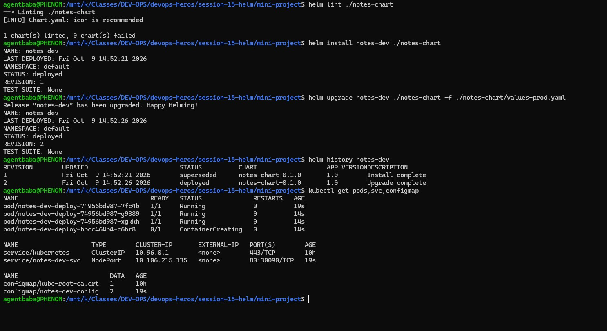
