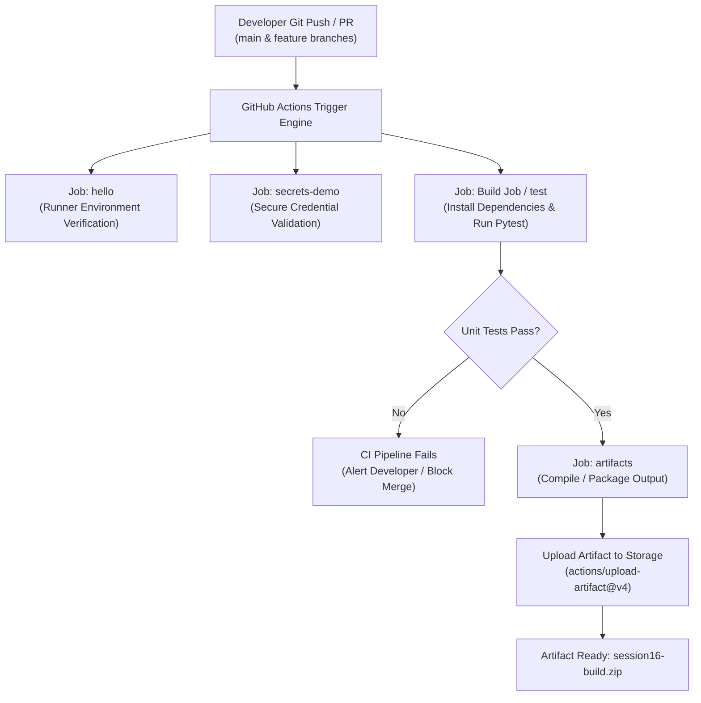
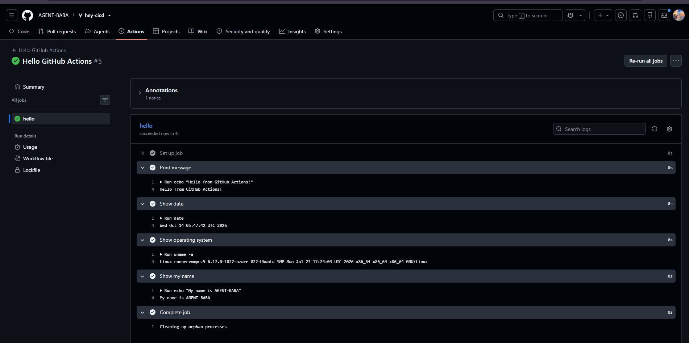
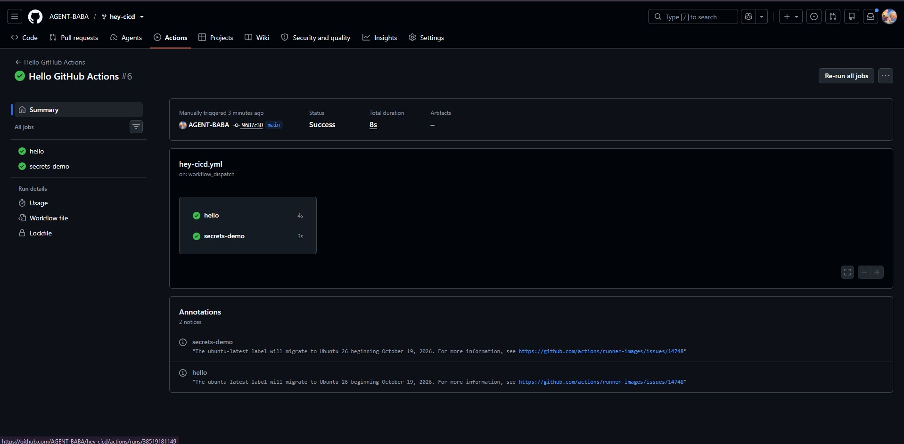
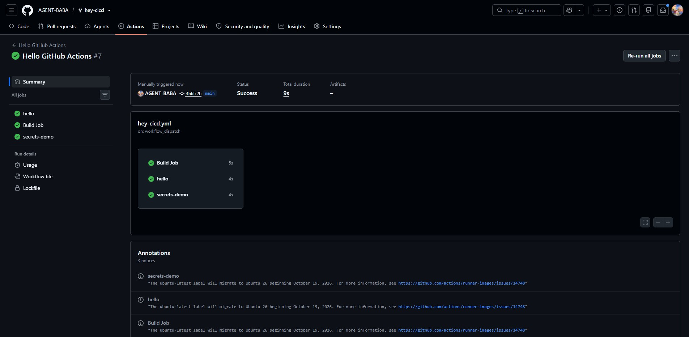
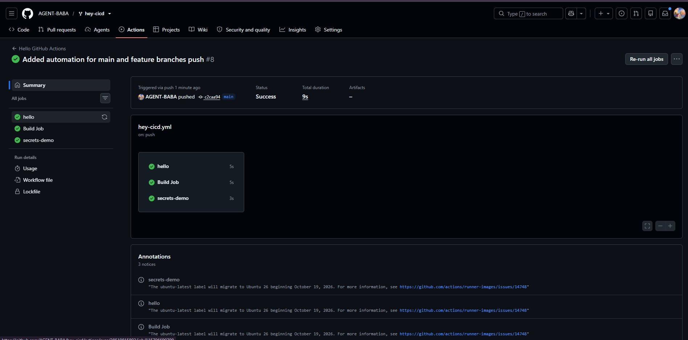
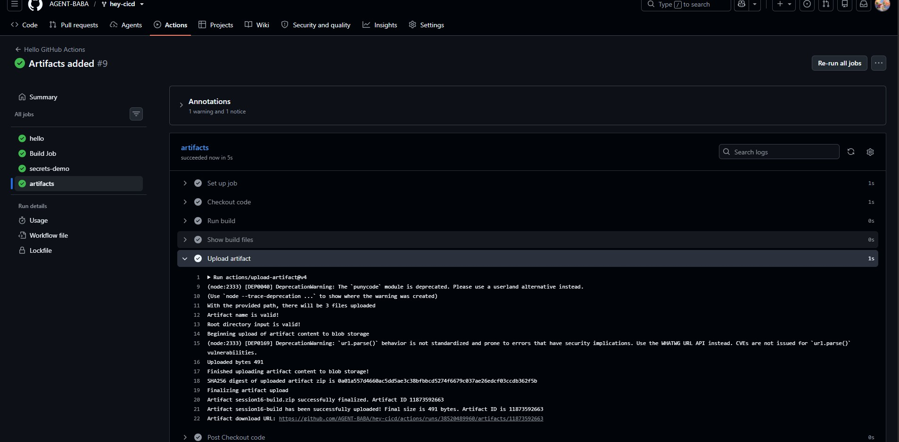
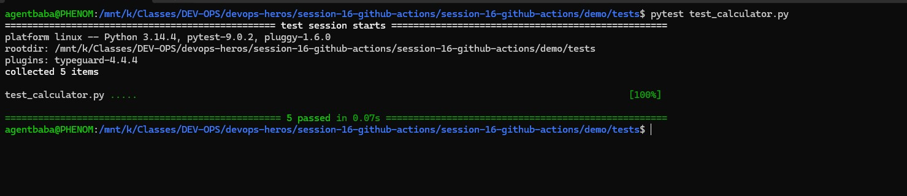

# Session 16: CI/CD and GitHub Actions — Automated Build, Test & Artifact Pipelines

A comprehensive submission guide, architectural breakdown, and hands-on verification report for Continuous Integration and Continuous Delivery (CI/CD) implemented with **GitHub Actions** on the **`hey-cicd`** repository.

---

## Table of Contents

- [Overview & Core Philosophy](#overview--core-philosophy)
- [CI/CD Core Pillars](#cicd-core-pillars)
- [Pipeline Architecture](#pipeline-architecture)
- [Hands-on Verification & Submission Proofs](#hands-on-verification--submission-proofs)
  - [Part 1 — Hello GitHub Actions: First Workflow & Runner Environment](#part-1--hello-github-actions-first-workflow--runner-environment)
  - [Part 2 — Managing Repository Secrets & Secure Environment Variables](#part-2--managing-repository-secrets--secure-environment-variables)
  - [Part 3 — Multi-Job Orchestration: Parallel & Sequential Jobs](#part-3--multi-job-orchestration-parallel--sequential-jobs)
  - [Part 4 — Event-Driven CI Automation: Automated Push Triggers](#part-4--event-driven-ci-automation-automated-push-triggers)
  - [Part 5 — Artifact Packaging & Upload (`actions/upload-artifact@v4`)](#part-5--artifact-packaging--upload-actionsupload-artifactv4)
  - [Part 6 — Automated Python Testing with Pytest (CI Test Stage)](#part-6--automated-python-testing-with-pytest-ci-test-stage)
- [Complete Consolidated Workflow Reference](#complete-consolidated-workflow-reference)
- [Useful Commands & Debugging Tips](#useful-commands--debugging-tips)
- [Key Takeaways](#key-takeaways)

---

## Overview & Core Philosophy

In traditional software development, building, testing, packaging, and deploying code manually creates bottlenecks, inconsistent environments, and release failures. 

**CI/CD (Continuous Integration and Continuous Delivery/Deployment)** automates the entire software delivery lifecycle:
- **Continuous Integration (CI):** Every code commit automatically triggers isolated builds and automated unit/integration test suites to detect regressions early.
- **Continuous Delivery (CD):** After tests pass, code is automatically packaged into release artifacts or container images, ready for deployment to any staging or production environment.
- **Continuous Deployment (CD):** Automated deployment directly into production without human intervention if all pipeline stages pass.

**GitHub Actions** provides native, cloud-hosted automation integrated directly into GitHub repositories, executing event-driven workflows on managed virtual runners (`ubuntu-latest`, `windows-latest`, `macos-latest`) or self-hosted machines.

---

## CI/CD Core Pillars

| Concept | Description |
|---|---|
| **Workflow** | Configurable automated process defined in YAML under `.github/workflows/`. |
| **Trigger (`on`)** | Specific GitHub event that starts the workflow (e.g., `push`, `pull_request`, `workflow_dispatch`, `schedule`). |
| **Job** | Set of sequential steps that execute on the same runner instance. Jobs run in parallel by default, or sequentially using `needs:`. |
| **Step** | Individual task within a job. Can be an action (`uses:`) or shell command (`run:`). |
| **Action** | Reusable, community-tested automation block from GitHub Marketplace (e.g., `actions/checkout@v4`, `actions/upload-artifact@v4`). |
| **Runner** | Server hosting an isolated VM or container where jobs execute (GitHub-hosted or self-hosted). |
| **Secrets** | Encrypted credentials stored securely in GitHub Settings and injected via `${{ secrets.NAME }}` with automatic log masking. |
| **Artifacts** | Files, binaries, reports, or packages generated during a job and preserved after the runner terminates. |

---

## Pipeline Architecture



---

## Hands-on Verification & Submission Proofs

### Part 1 — Hello GitHub Actions: First Workflow & Runner Environment

#### Why
Validates basic GitHub Actions syntax, runner provisioning (`ubuntu-latest`), and step execution for essential system commands (`echo`, `date`, `uname -a`) using manual dispatch (`workflow_dispatch`).

#### Workflow Configuration (`hey-cicd.yml` snippet)

```yaml
name: Hello GitHub Actions

on:
  workflow_dispatch:

jobs:
  hello:
    runs-on: ubuntu-latest
    steps:
      - name: Print message
        run: echo "Hello from GitHub Actions!"
      - name: Show date
        run: date
      - name: Show operating system
        run: uname -a
      - name: Show my name
        run: echo "My name is AGENT-BABA"
```

#### Expected Output
- GitHub provisions an Ubuntu 24.04/26.04 LTS runner VM.
- Steps execute sequentially in under 4 seconds.
- `uname -a` prints the Linux kernel version and runner hostname.
- Custom greeting and timestamp are logged to the console output.

#### Terminal Proof / Screenshot



---

### Part 2 — Managing Repository Secrets & Secure Environment Variables

#### Why
Verifies how sensitive credentials, API keys, and environment tokens are stored encrypted in GitHub Repository Settings (`Settings > Secrets and variables > Actions`) and passed into workflow steps using `${{ secrets.SECRET_NAME }}` while ensuring secrets are masked (`***`) in console logs.

#### Workflow Configuration (`hey-cicd.yml` snippet)

```yaml
  secrets-demo:
    runs-on: ubuntu-latest
    steps:
      - name: Check secret
        env:
          DEMO_SECRET: ${{ secrets.DEMO_SECRET }}
        run: |
          if [ -n "$DEMO_SECRET" ]; then
            echo "Secret is available."
          else
            echo "Secret is not configured."
            exit 1
          fi
```

#### Expected Output
- Runner retrieves the encrypted secret from GitHub's secret store at runtime.
- Workflow evaluates condition: `Secret is available.`
- No cleartext credentials appear in runner logs or telemetry.

#### Terminal Proof / Screenshot



---

### Part 3 — Multi-Job Orchestration: Parallel & Sequential Jobs

#### Why
Demonstrates defining multiple independent jobs (`hello`, `Build Job`, `secrets-demo`) within a single workflow. By default, independent jobs run concurrently across separate runner VMs, drastically decreasing overall pipeline runtime.

#### Workflow Configuration (`hey-cicd.yml` snippet)

```yaml
jobs:
  hello:
    runs-on: ubuntu-latest
    steps:
      - run: echo "Hello from GitHub Actions!"
      
  Build Job:
    runs-on: ubuntu-latest
    steps:
      - name: Checkout code
        uses: actions/checkout@v4
      - name: Build application
        run: echo "Building application..."
      - name: Build completed
        run: echo "Build successful!"

  secrets-demo:
    runs-on: ubuntu-latest
    steps:
      - name: Verify Secret
        run: echo "Validating secret access..."
```

#### Expected Output
- Workflow visualizer renders all 3 jobs (`Build Job`, `hello`, `secrets-demo`).
- All 3 jobs complete successfully in parallel within ~9 seconds total duration.

#### Terminal Proof / Screenshot



---

### Part 4 — Event-Driven CI Automation: Automated Push Triggers

#### Why
Transitions the workflow from manual invocation (`workflow_dispatch`) to automated Continuous Integration triggered on git events (`on: push` across `main` and feature branches). Every commit pushed to the repository automatically triggers the full CI suite.

#### Workflow Configuration (`hey-cicd.yml` snippet)

```yaml
name: Hello GitHub Actions

on:
  push:
    branches:
      - main
      - 'feature/**'
  workflow_dispatch:
```

#### Expected Output
- Pushing commit `c2caa94` with message *"Added automation for main and feature branches push"* instantly triggers Run #8.
- Workflow executes automatically without requiring manual interaction in the GitHub UI.

#### Terminal Proof / Screenshot



---

### Part 5 — Artifact Packaging & Upload (`actions/upload-artifact@v4`)

#### Why
Runner virtual machines are ephemeral and wiped immediately after a job completes. To preserve build output, compiled binaries, documentation, or deployment bundles, workflows use `actions/upload-artifact@v4` to store artifacts in GitHub cloud storage for downstream deployment jobs or manual download.

#### Workflow Configuration (`hey-cicd.yml` snippet)

```yaml
  artifacts:
    runs-on: ubuntu-latest
    steps:
      - name: Checkout code
        uses: actions/checkout@v4
      - name: Run build
        run: |
          chmod +x build.sh
          ./build.sh
      - name: Show build files
        run: |
          echo "Build output:"
          ls -la build
      - name: Upload artifact
        uses: actions/upload-artifact@v4
        with:
          name: session16-build
          path: build/
          retention-days: 7
```

#### Expected Output
- Build script generates artifacts inside `./build`.
- `actions/upload-artifact@v4` bundles files into a zip archive (`session16-build`, 491 bytes) and uploads to GitHub blob storage.
- The artifact is attached to Run #9 and made available for download.

#### Terminal Proof / Screenshot



---

### Part 6 — Automated Python Testing with Pytest (CI Test Stage)

#### Why
Validates the test stage of the CI pipeline by running automated unit tests for the Python Calculator application (`app/calculator.py` and `tests/test_calculator.py`) using `pytest`. Verifies that faulty business logic or unhandled exceptions fail the build before packaging occurs.

#### Test Suite Implementation (`tests/test_calculator.py`)

```python
import pytest
from app.calculator import add, subtract, multiply, divide

def test_add():
    assert add(10, 5) == 15

def test_subtract():
    assert subtract(10, 5) == 5

def test_multiply():
    assert multiply(10, 5) == 50

def test_divide():
    assert divide(10, 5) == 2

def test_divide_by_zero():
    with pytest.raises(ValueError):
        divide(10, 0)
```

#### Commands Executed

```bash
# Navigate to the test directory
cd /mnt/k/Classes/DEV-OPS/devops-heros/session-16-github-actions/session-16-github-actions/demo/tests

# Execute pytest suite
pytest test_calculator.py
```

#### Expected Output
- Pytest discovers and runs 5 test functions.
- 100% tests pass (`5 passed in 0.07s`).
- Exit code `0` confirms the build gate passes successfully.

#### Terminal Proof / Screenshot



---

## Complete Consolidated Workflow Reference

Below is the complete, production-grade GitHub Actions workflow YAML (`.github/workflows/ci.yml`) integrating all concepts tested across Session 16:

```yaml
name: Python CI/CD Pipeline

on:
  push:
    branches:
      - main
      - 'feature/**'
  pull_request:
    branches:
      - main
  workflow_dispatch:

jobs:
  test:
    name: Test Application
    runs-on: ubuntu-latest
    steps:
      - name: Checkout Source Code
        uses: actions/checkout@v4

      - name: Set up Python
        uses: actions/setup-python@v5
        with:
          python-version: "3.12"

      - name: Install Dependencies
        run: |
          python -m pip install --upgrade pip
          pip install -r requirements.txt

      - name: Run Unit Tests with Pytest
        run: |
          pytest -v

  build:
    name: Build & Package Artifact
    needs: test
    runs-on: ubuntu-latest
    steps:
      - name: Checkout Source Code
        uses: actions/checkout@v4

      - name: Set up Python
        uses: actions/setup-python@v5
        with:
          python-version: "3.12"

      - name: Run Build Script
        run: |
          chmod +x build.sh
          ./build.sh

      - name: Verify Build Output
        run: |
          ls -la build/
          cat build/build-info.txt || true

      - name: Upload Build Artifact
        uses: actions/upload-artifact@v4
        with:
          name: calculator-build
          path: build/
          retention-days: 14

  secrets-check:
    name: Verify Secrets Integration
    runs-on: ubuntu-latest
    steps:
      - name: Validate Secret Presence
        env:
          DEMO_SECRET: ${{ secrets.DEMO_SECRET }}
        run: |
          if [ -n "$DEMO_SECRET" ]; then
            echo "[SUCCESS] Repository secrets configured and accessible."
          else
            echo "[WARNING] DEMO_SECRET is not configured."
          fi
```

---

## Useful Commands & Debugging Tips

```bash
# 1. Inspect GitHub Actions workflows with GitHub CLI
gh workflow list
gh workflow run ci.yml

# 2. View active and historical workflow runs
gh run list --limit 10
gh run view <RUN_ID> --log

# 3. Test workflows locally without pushing to GitHub using act
# Install act: brew install act OR choco install act-cli
act -l
act push

# 4. Run Pytest locally with coverage report
python -m pytest -v --cov=app --cov-report=term-missing
```

---

## Key Takeaways

1. **Fail Fast with CI**: Running `pytest` on every push catches logic bugs and regressions within seconds, preventing broken code from reaching the mainline.
2. **Secrets Hygiene**: Never hardcode credentials in code or YAML files. Always use GitHub Encrypted Secrets, which are masked automatically in pipeline logs.
3. **Artifact Persistence**: Because runners are destroyed upon job completion, any file or build binary required downstream must be explicitly persisted using `actions/upload-artifact@v4`.
4. **Job Dependencies with `needs`**: Independent jobs run in parallel to maximize throughput, while deployment or packaging jobs depend sequentially on test success via `needs: [test]`.
