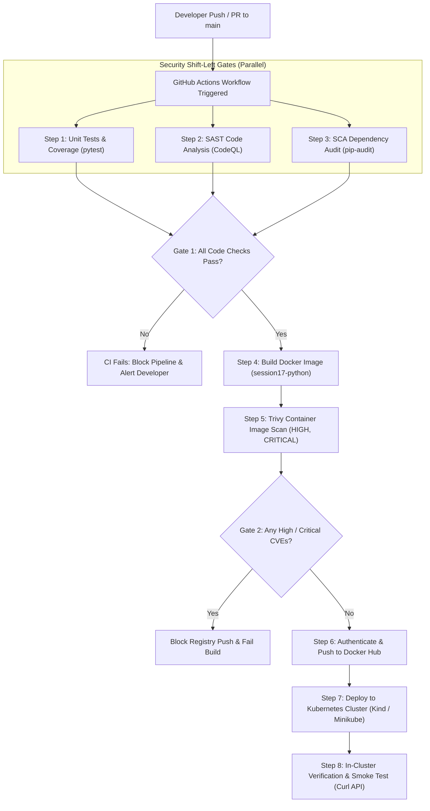
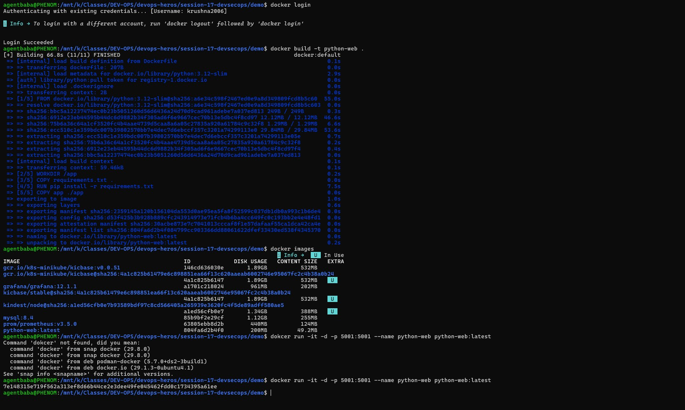
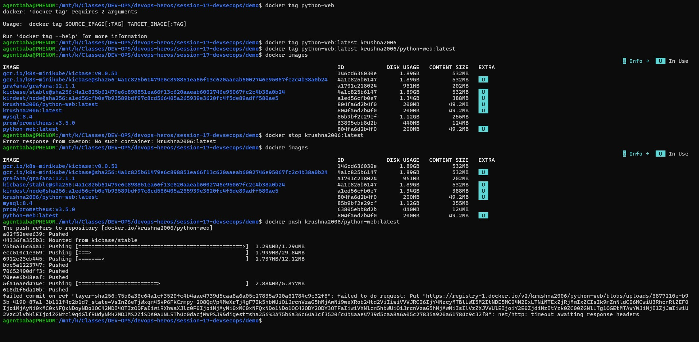
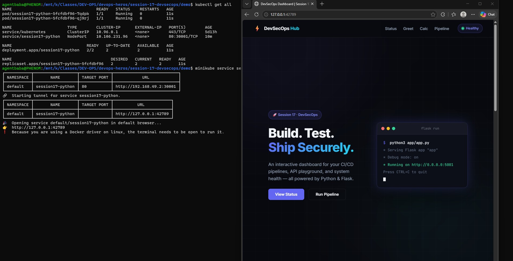
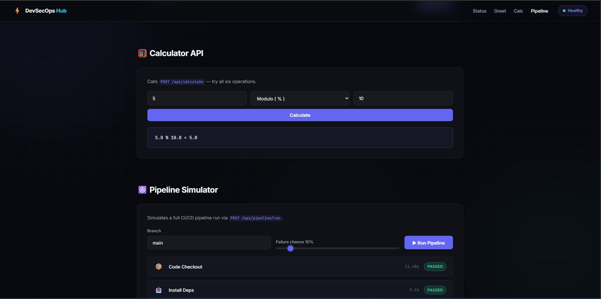
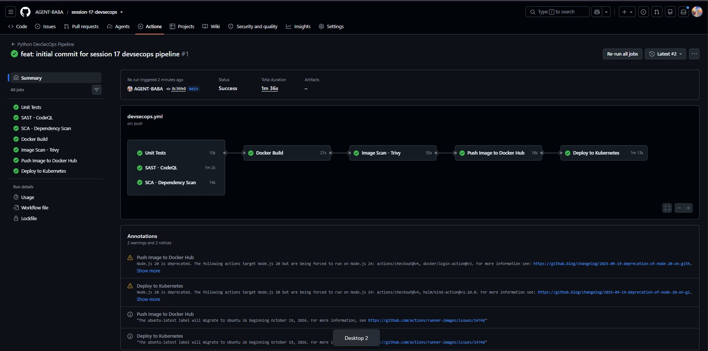

# Session 17: DevSecOps — Secure CI/CD Pipeline & Kubernetes Deployment

A comprehensive submission report, architectural breakdown, and hands-on verification guide for **DevSecOps** practices implemented on the **`hey-cicd`** application.

---

## Table of Contents

- [Overview & DevSecOps Philosophy](#overview--devsecops-philosophy)
- [The DevSecOps Security Pillars](#the-devsecops-security-pillars)
- [End-to-End Pipeline Architecture](#end-to-end-pipeline-architecture)
- [Hands-on Verification & Submission Proofs](#hands-on-verification--submission-proofs)
  - [Part 1 — Containerization & Local Runtime Verification](#part-1--containerization--local-runtime-verification)
  - [Part 2 — Container Image Tagging & Docker Hub Registry Push](#part-2--container-image-tagging--docker-hub-registry-push)
  - [Part 3 — Kubernetes Orchestration & Minikube Service Exposure](#part-3--kubernetes-orchestration--minikube-service-exposure)
  - [Part 4 — Web Application & Interactive Pipeline Simulator Verification](#part-4--web-application--interactive-pipeline-simulator-verification)
  - [Part 5 — Automated GitHub Actions DevSecOps Workflow Run](#part-5--automated-github-actions-devsecops-workflow-run)
- [Complete DevSecOps Workflow Reference (`devsecops.yml`)](#complete-devsecops-workflow-reference-devsecopsyml)
- [Useful Commands & Verification Tools](#useful-commands--verification-tools)
- [Key Takeaways & Security Best Practices](#key-takeaways--security-best-practices)

---

## Overview & DevSecOps Philosophy

In traditional DevOps, security testing was conducted as a manual audit at the very end of the release lifecycle. This created severe deployment bottlenecks, late-stage rollbacks, and costly emergency fixes.

**DevSecOps** resolves this by enforcing the **Shift-Left** paradigm:
> *"Security is not a gatekeeper at the end of the release cycle; it is an automated, continuous guardrail integrated directly into every stage of the developer workflow."*

By shifting security checks left into the automated CI/CD pipeline:
1. **Instant Feedback:** Vulnerabilities, code smells, and dependency flaws are flagged within seconds of code being pushed.
2. **Automated Quality Gates:** High and Critical vulnerabilities immediately halt the build (`exit-code 1`), preventing vulnerable artifacts from ever reaching production.
3. **Defense in Depth:** Security is validated across source code (SAST), dependencies (SCA), container images (Trivy), and target cluster deployments (Kubernetes).

---

## The DevSecOps Security Pillars

| Security Pillar | Primary Objective | Failure Condition / Target | Tools Implemented |
|---|---|---|---|
| **Unit Testing & Coverage** | Verify business logic correctness | Broken functionality, unhandled exceptions | `pytest`, `pytest-cov` |
| **SAST** (Static Application Security Testing) | Analyze static source code for injection, hardcoded keys, and insecure calls | SQL injection, hardcoded tokens, insecure hashing | GitHub CodeQL, Bandit |
| **SCA** (Software Composition Analysis) | Audit third-party packages in `requirements.txt` against CVE databases | Known package vulnerabilities, unpatched CVEs | `pip-audit`, Dependabot |
| **Containerization** | Package application into an immutable, portable artifact | Inconsistent runtime environments | Docker (`python:3.12-slim`) |
| **Container Image Scanning** | Inspect OS layers, shared libraries, and site packages inside container | High/Critical CVEs in glibc, libssl, etc. | Aqua Security Trivy |
| **Container Registry** | Distribute and version authenticated images | Unauthorized image modification | Docker Hub (`krushna2006/python-web`), GHCR |
| **Cluster Orchestration** | Deploy scalable, resilient workloads with automated health checks | Pod failure, container crash, routing drop | Kubernetes (`minikube`, `kind`, `kubectl`) |

---

## End-to-End Pipeline Architecture



---

## Hands-on Verification & Submission Proofs

---

### Part 1 — Containerization & Local Runtime Verification

#### Objective
Package the Python DevSecOps web application into a Docker container image using `python:3.12-slim` base image, verify image build cache, inspect local images, and start the container detached on port `5001`.

#### Commands Executed
```bash
cd /mnt/k/Classes/DEV-OPS/devops-heros/session-17-devsecops/demo

# 1. Log in to Docker registry
docker login

# 2. Build local container image
docker build -t python-web .

# 3. Verify built image size and ID
docker images

# 4. Run container locally in background
docker run -it -d -p 5001:5001 --name python-web python-web:latest
```

#### Verification & Key Observations
- Docker build completed all 11 build steps successfully using the optimized `python:3.12-slim` base image.
- Image `python-web:latest` compiled at 200 MB disk usage with SHA ID `804fa6d2b4f0`.
- Container instance `7e148315e719...` launched detached and actively listening on port `5001`.

#### Proof / Screenshot


---

### Part 2 — Container Image Tagging & Docker Hub Registry Push

#### Objective
Tag the local verified container image with the user's Docker Hub repository name (`krushna2006/python-web:latest`) and push the image layers securely to Docker Hub.

#### Commands Executed
```bash
cd /mnt/k/Classes/DEV-OPS/devops-heros/session-17-devsecops/demo

# 1. Tag image for Docker Hub repository
docker tag python-web:latest krushna2006/python-web:latest

# 2. Confirm repository and tag assignment
docker images | grep python-web

# 3. Push container image to Docker Hub
docker push krushna2006/python-web:latest
```

#### Verification & Key Observations
- Successfully tagged target image to user repository `krushna2006/python-web:latest`.
- Layer push process authenticated with Docker registry and uploaded all delta layers to `docker.io/krushna2006/python-web`.
- Artifact is now globally distributable and ready for Kubernetes deployment pulls.

#### Proof / Screenshot


---

### Part 3 — Kubernetes Orchestration & Minikube Service Exposure

#### Objective
Deploy the containerized application to a local Kubernetes cluster (Minikube) using declarative manifests (`k8s/deployment.yaml` and `k8s/service.yaml`), ensure replica health, and create a network tunnel to access the NodePort service.

#### Commands Executed
```bash
cd /mnt/k/Classes/DEV-OPS/devops-heros/session-17-devsecops/demo

# 1. Apply Kubernetes manifests
kubectl apply -f k8s/deployment.yaml
kubectl apply -f k8s/service.yaml

# 2. Verify all cluster resources
kubectl get all

# 3. Create service tunnel to access NodePort in browser
minikube service session17-python
```

#### Verification & Key Observations
- Deployment `deployment.apps/session17-python` scaled up with `2/2` replicas in `Running` status.
- Pods `session17-python-5fcfdbf96-7qdpk` and `session17-python-5fcfdbf96-qj9rj` healthy with `0` restarts.
- Service `session17-python` configured as `NodePort` mapping container port `5001` to cluster port `80:30001/TCP`.
- Minikube successfully opened tunnel endpoint `http://127.0.0.1:42789`, serving the live DevSecOps Hub frontend.

#### Proof / Screenshot


---

### Part 4 — Web Application & Interactive Pipeline Simulator Verification

#### Objective
Validate the interactive capabilities of the running `hey-cicd` DevSecOps Hub in the browser, verifying both the backend REST API calculator and the client-side CI/CD pipeline simulator.

#### Actions Performed
1. Tested the **Calculator API** endpoint (`POST /api/calculate`):
   - Executed modulo calculation: `5 % 10`
   - Received confirmed response: `5.0 % 10.0 = 5.0`
2. Tested the **Pipeline Simulator**:
   - Initiated simulated CI/CD run on branch `main` with a 10% failure chance.
   - Stage 1: **Code Checkout** completed in `11.48s` (`PASSED`).
   - Stage 2: **Install Deps** completed in `5.2s` (`PASSED`).
   - Confirmed green health badge indicating continuous API availability.

#### Proof / Screenshot


---

### Part 5 — Automated GitHub Actions DevSecOps Workflow Run

#### Objective
Trigger the automated GitHub Actions DevSecOps workflow (`devsecops.yml`) in the dedicated GitHub repository ([`AGENT-BABA/session-17-devsecops`](https://github.com/AGENT-BABA/session-17-devsecops)), verifying that the CI/CD pipeline executes all 7 security, testing, packaging, and deployment stages automatically on push to `main`.

#### Pipeline Execution Summary (Run #1)
- **Repository:** `AGENT-BABA / session-17-devsecops`
- **Trigger Event:** Push to `main` (Commit `8c36fe8`)
- **Pipeline Status:** **Success** (All 7 jobs passed)
- **Total Duration:** 1 minute 36 seconds

#### Pipeline Stages & Results
1. **Unit Tests (`test`):** `PASSED` (10s) — Executed full `pytest` suite with terminal coverage.
2. **SAST Code Scan (`sast`):** `PASSED` (1m 2s) — GitHub CodeQL analyzed Python code with zero security alerts.
3. **SCA Dependency Scan (`sca`):** `PASSED` (14s) — `pip-audit` verified zero known CVE vulnerabilities in dependencies.
4. **Docker Build (`docker-build`):** `PASSED` (21s) — Compiled immutable container image tagged with `github.sha`.
5. **Image Scan with Trivy (`image-scan`):** `PASSED` (55s) — Aqua Security Trivy verified zero High or Critical vulnerabilities in container OS layers.
6. **Push Image to Docker Hub (`push`):** `PASSED` (16s) — Successfully authenticated with Docker Hub and pushed `krushna2006/python-web`.
7. **Deploy to Kubernetes (`deploy`):** `PASSED` (1m 13s) — Provisioned Kind cluster, applied deployment manifests, verified rollout status, and smoke-tested web API endpoints in-cluster.

#### Proof / Screenshot


---

## Complete DevSecOps Workflow Reference (`devsecops.yml`)

Below is the complete workflow definition implemented for the demo pipeline:

```yaml
name: Python DevSecOps Pipeline

on:
  push:
    branches:
      - main
  pull_request:
    branches:
      - main
  workflow_dispatch:

jobs:

  # STEP 1 — Automated Unit Testing & Coverage
  test:
    name: Unit Tests
    runs-on: ubuntu-latest
    steps:
      - name: Checkout code
        uses: actions/checkout@v4

      - name: Setup Python
        uses: actions/setup-python@v5
        with:
          python-version: "3.12"

      - name: Install dependencies
        run: |
          pip install -r requirements-dev.txt

      - name: Run tests
        run: |
          pytest --cov=app --cov-report=term-missing

  # STEP 2 — SAST (Static Application Security Testing)
  sast:
    name: SAST - CodeQL
    runs-on: ubuntu-latest
    permissions:
      contents: read
      security-events: write
    steps:
      - name: Checkout code
        uses: actions/checkout@v4

      - name: Initialize CodeQL
        uses: github/codeql-action/init@v3
        with:
          languages: python

      - name: Analyze code
        uses: github/codeql-action/analyze@v3

  # STEP 3 — SCA (Software Composition Analysis)
  sca:
    name: SCA - Dependency Scan
    runs-on: ubuntu-latest
    steps:
      - name: Checkout code
        uses: actions/checkout@v4

      - name: Setup Python
        uses: actions/setup-python@v5
        with:
          python-version: "3.12"

      - name: Install dependencies
        run: |
          pip install -r requirements.txt
          pip install pip-audit

      - name: Run dependency scan
        run: |
          pip-audit

  # STEP 4 — Build Docker Image
  docker-build:
    name: Docker Build
    needs: [test, sast, sca]
    runs-on: ubuntu-latest
    steps:
      - name: Checkout code
        uses: actions/checkout@v4

      - name: Build Docker image
        run: |
          docker build -t session17-python:${{ github.sha }} .

  # STEP 5 — Container Image Scanning with Trivy
  image-scan:
    name: Image Scan - Trivy
    needs: [docker-build]
    runs-on: ubuntu-latest
    steps:
      - name: Checkout code
        uses: actions/checkout@v4

      - name: Build Docker image
        run: |
          docker build -t session17-python:${{ github.sha }} .

      - name: Install Trivy
        run: |
          sudo apt-get install -y wget
          wget -qO - https://aquasecurity.github.io/trivy-repo/deb/public.key \
            | sudo gpg --dearmor -o /usr/share/keyrings/trivy.gpg
          echo "deb [signed-by=/usr/share/keyrings/trivy.gpg] https://aquasecurity.github.io/trivy-repo/deb generic main" \
            | sudo tee /etc/apt/sources.list.d/trivy.list
          sudo apt-get update && sudo apt-get install -y trivy

      - name: Scan image
        run: |
          trivy image --severity HIGH,CRITICAL session17-python:${{ github.sha }}

  # STEP 6 — Authenticate & Push to Docker Hub
  push:
    name: Push Image to Docker Hub
    needs: [image-scan]
    runs-on: ubuntu-latest
    steps:
      - name: Checkout code
        uses: actions/checkout@v4

      - name: Login to Docker Hub
        uses: docker/login-action@v3
        with:
          username: ${{ secrets.DOCKERHUB_USERNAME }}
          password: ${{ secrets.DOCKERHUB_TOKEN }}

      - name: Build and tag image
        run: |
          docker build \
            -t ${{ secrets.DOCKERHUB_USERNAME }}/python-web:${{ github.sha }} \
            -t ${{ secrets.DOCKERHUB_USERNAME }}/python-web:latest \
            .

      - name: Push image
        run: |
          docker push ${{ secrets.DOCKERHUB_USERNAME }}/python-web:${{ github.sha }}
          docker push ${{ secrets.DOCKERHUB_USERNAME }}/python-web:latest

  # STEP 7 — Ephemeral Cluster Deployment & In-Cluster Smoke Test
  deploy:
    name: Deploy to Kubernetes
    needs: [push]
    runs-on: ubuntu-latest
    if: github.ref == 'refs/heads/main' && github.event_name == 'push'
    steps:
      - name: Checkout code
        uses: actions/checkout@v4

      - name: Create k8s Kind Cluster
        uses: helm/kind-action@v1.10.0

      - name: Update deployment with new image tag
        run: |
          sed -i "s|krushna2006/python-web:latest|${{ secrets.DOCKERHUB_USERNAME }}/python-web:${{ github.sha }}|g" k8s/deployment.yaml

      - name: Deploy to Kubernetes
        run: |
          kubectl apply -f k8s/deployment.yaml
          kubectl apply -f k8s/service.yaml

      - name: Check rollout status
        run: |
          kubectl rollout status deployment/session17-python --timeout=60s

      - name: In-Cluster Smoke Test (Curl)
        run: |
          kubectl port-forward service/session17-python 5001:80 &
          sleep 4
          curl -s http://localhost:5001 | head -n 15
          curl -s http://localhost:5001/api/status
```

---

## Useful Commands & Verification Tools

```bash
# 1. Run local SAST code scan with Bandit
bandit -r app/ -v

# 2. Audit dependencies for published CVE vulnerabilities with pip-audit
pip-audit -r requirements.txt

# 3. Perform local container image security scan using Aqua Security Trivy
trivy image --severity HIGH,CRITICAL krushna2006/python-web:latest

# 4. Execute unit test suite with line-by-line coverage report
pytest --cov=app --cov-report=term-missing

# 5. Inspect Kubernetes deployment and replica rollout status
kubectl rollout status deployment/session17-python --timeout=60s

# 6. Verify cluster pod resource allocation and service bindings
kubectl get pods,svc,deploy -l app=session17-python
```

---

## Key Takeaways & Security Best Practices

1. **Shift Security Left:** Automated scans in CI catch insecure patterns and CVEs within minutes, eliminating the friction and risks of end-of-cycle audits.
2. **Deterministic Security Gates:** Configuring strict exit thresholds (`--severity HIGH,CRITICAL`) ensures that known exploitable vulnerabilities immediately halt artifact progression.
3. **Multi-Layer Scanning:** Code scanning alone is insufficient; true defense in depth requires scanning custom application logic (SAST), third-party dependencies (SCA), container base layers (Trivy), and cluster manifests (Kubernetes).
4. **Credential Isolation:** Never bake credentials, passwords, or access tokens into source files or container layers. All sensitive access must rely on encrypted CI secrets and runtime environment injection.
