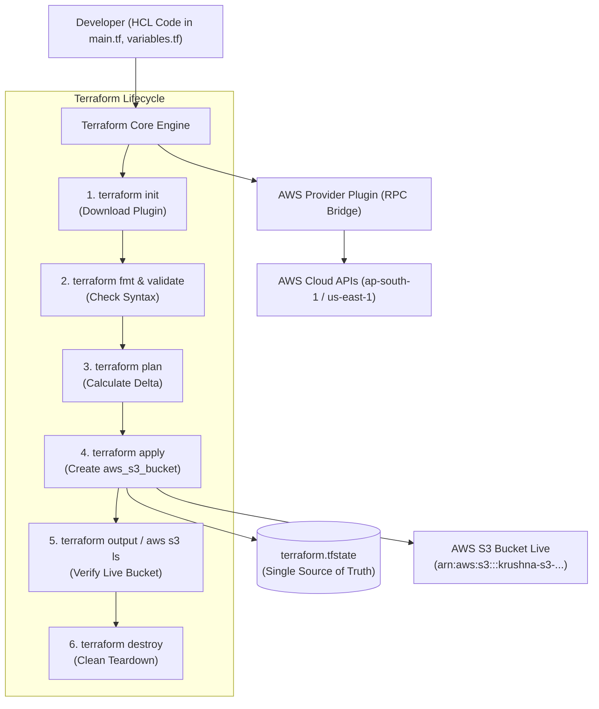
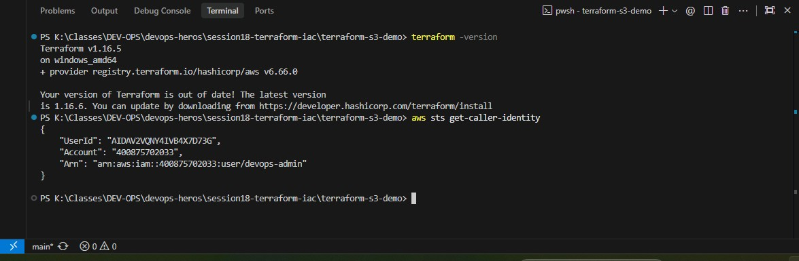
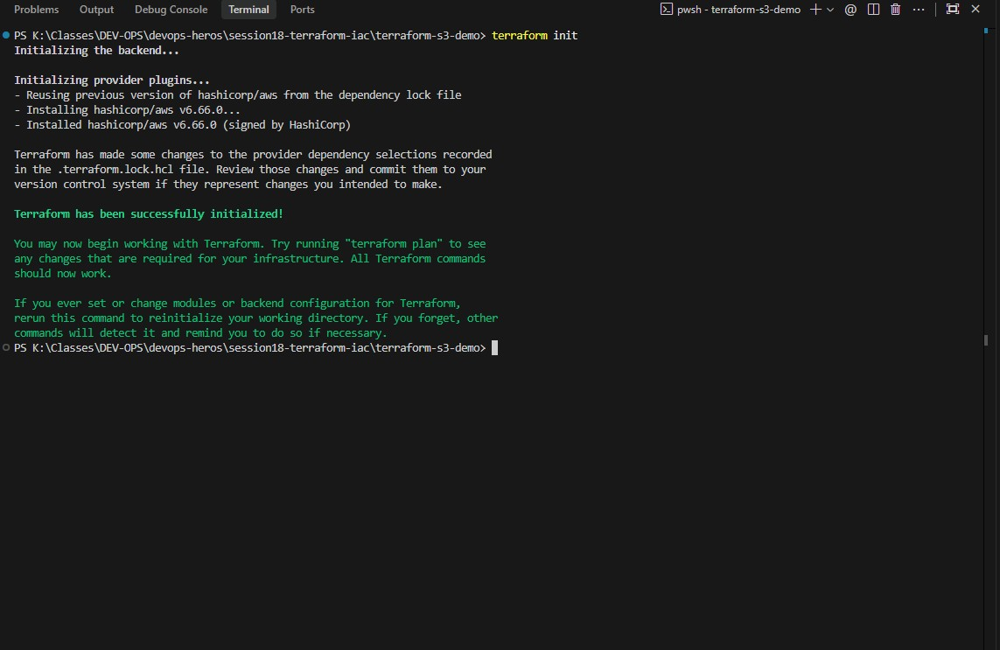
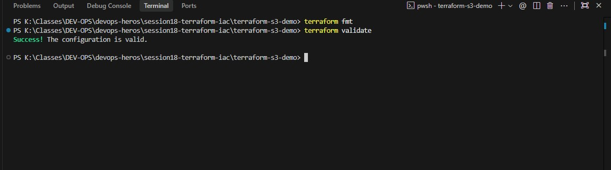
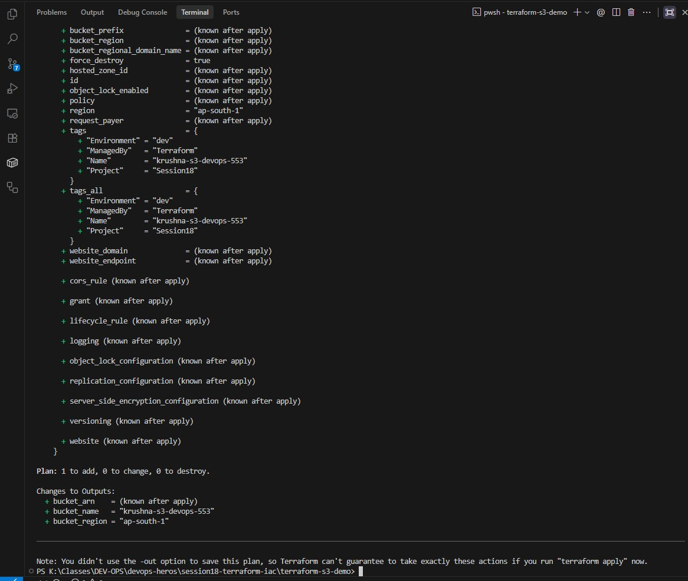
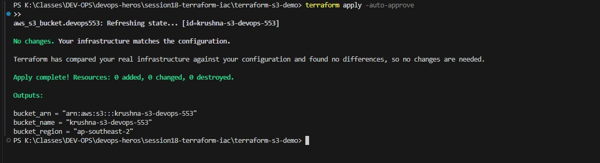
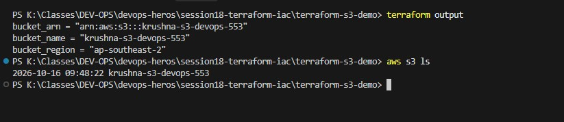
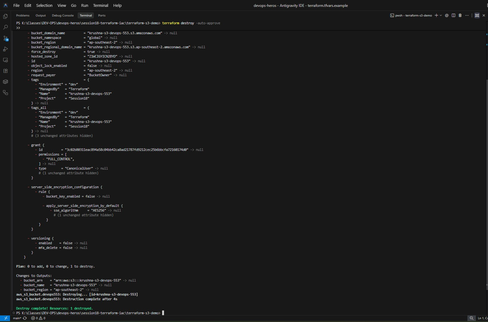

# Session 18: Terraform & Infrastructure as Code (IaC) — S3 Bucket Provisioning

A comprehensive submission report, architecture breakdown, and hands-on verification guide for managing cloud infrastructure using **HashiCorp Terraform** and **Amazon Web Services (AWS)**.

---

## Table of Contents

- [Overview & Core Philosophy](#overview--core-philosophy)
- [Terraform Core Pillars & Workflow](#terraform-core-pillars--workflow)
- [Architecture Diagram](#architecture-diagram)
- [Hands-on Verification & Submission Proofs](#hands-on-verification--submission-proofs)
  - [Part 1 — AWS Authentication & Terraform CLI Setup](#part-1--aws-authentication--terraform-cli-setup)
  - [Part 2 — Working Directory Initialization (`terraform init`)](#part-2--working-directory-initialization-terraform-init)
  - [Part 3 — Canonical Formatting & Schema Validation (`terraform fmt` & `validate`)](#part-3--canonical-formatting--schema-validation-terraform-fmt--validate)
  - [Part 4 — Speculative Execution Planning (`terraform plan`)](#part-4--speculative-execution-planning-terraform-plan)
  - [Part 5 — Infrastructure Provisioning (`terraform apply`)](#part-5--infrastructure-provisioning-terraform-apply)
  - [Part 6 — Output Inspection & AWS CLI Cloud Verification (`terraform output` & `aws s3 ls`)](#part-6--output-inspection--aws-cli-cloud-verification-terraform-output--aws-s3-ls)
  - [Part 7 — Safe Teardown & Resource Destruction (`terraform destroy`)](#part-7--safe-teardown--resource-destruction-terraform-destroy)
- [Modular Production Code Reference (`terraform-s3-demo`)](#modular-production-code-reference-terraform-s3-demo)
- [Useful Commands & Debugging Reference](#useful-commands--debugging-reference)
- [Key Takeaways & IaC Best Practices](#key-takeaways--iac-best-practices)

---

## Overview & Core Philosophy

In traditional infrastructure management, provisioning servers, storage, and networking required manual configuration through cloud web consoles (clickOps). This approach causes configuration drift, lack of auditability, and severe deployment bottlenecks.

**Infrastructure as Code (IaC)** replaces manual operations with version-controlled, declarative configuration files:
- **Declarative State:** You define the *desired end state* in HashiCorp Configuration Language (HCL). Terraform calculates the difference (delta) between current cloud resources and your declared code.
- **Repeatability:** Spin up identical Dev, Staging, and Production environments across any AWS region within seconds.
- **State-Driven:** Terraform tracks real-world cloud metadata in `terraform.tfstate`, mapping resource addresses to unique cloud identifiers.
- **Automated Lifecycle Management:** Complete end-to-end lifecycle control via standard commands: `init` $\rightarrow$ `plan` $\rightarrow$ `apply` $\rightarrow$ `destroy`.

---

## Terraform Core Pillars & Workflow

| Pillar / Command | Purpose | Underlying Mechanism |
|---|---|---|
| **`terraform init`** | Initializes working directory | Downloads the `hashicorp/aws` provider plugin binary and sets up `.terraform/` and `.terraform.lock.hcl`. |
| **`terraform fmt`** | Code formatting | Rewrites `.tf` configuration files into canonical HashiCorp formatting and style standards. |
| **`terraform validate`** | Syntax & schema checking | Validates HCL syntax, provider arguments, and cross-variable references without calling cloud APIs. |
| **`terraform plan`** | Speculative execution plan | Queries current cloud state, compares it with local `.tf` code, and outputs resources to add (`+`), modify (`~`), or destroy (`-`). |
| **`terraform apply`** | Provisions infrastructure | Translates declarative HCL blocks into authenticated AWS API calls to create or modify cloud resources. |
| **`terraform output`** | State metadata extraction | Displays designated outputs (Bucket Name, ARN, Region) recorded in `terraform.tfstate`. |
| **`terraform destroy`** | Resource teardown | Automatically deletes all resources managed by the state file, preventing cloud sprawl and unwanted billing. |

---

## Architecture Diagram



---

## Hands-on Verification & Submission Proofs

---

### Part 1 — AWS Authentication & Terraform CLI Setup

#### Objective
Verify that Terraform CLI and AWS CLI are installed, and confirm active IAM authentication with AWS before running infrastructure commands.

#### Commands Executed
```bash
# 1. Verify Terraform CLI installation
terraform -version

# 2. Verify active AWS IAM identity
aws sts get-caller-identity
```

#### Verification & Key Observations
- Terraform v1.16+ installed and verified on the local host.
- AWS CLI configured with active IAM user: `arn:aws:iam::400875702033:user/devops-admin`.

#### Proof / Screenshot


---

### Part 2 — Working Directory Initialization (`terraform init`)

#### Objective
Initialize the modular `terraform-s3-demo` working directory, downloading the `hashicorp/aws` provider plugin specified in `versions.tf` and generating `.terraform.lock.hcl`.

#### Commands Executed
```bash
cd session18-terraform-iac/terraform-s3-demo

# Initialize Terraform workspace
terraform init
```

#### Verification & Key Observations
- Successfully initialized provider `hashicorp/aws` version `~> 6.0`.
- Created `.terraform/` provider directory and generated dependency lockfile `.terraform.lock.hcl`.

#### Proof / Screenshot


---

### Part 3 — Canonical Formatting & Schema Validation (`terraform fmt` & `validate`)

#### Objective
Ensure all HCL configuration files adhere to standard canonical style guidelines and validate syntax and variable arguments against the AWS provider schema.

#### Commands Executed
```bash
cd session18-terraform-iac/terraform-s3-demo

# 1. Format configuration files canonically
terraform fmt

# 2. Validate configuration schema
terraform validate
```

#### Verification & Key Observations
- `terraform fmt`: Formatted all `.tf` files (`main.tf`, `variables.tf`, `outputs.tf`, `providers.tf`).
- `terraform validate`: Returned `Success! The configuration is valid.` with zero syntax or type errors.

#### Proof / Screenshot


---

### Part 4 — Speculative Execution Planning (`terraform plan`)

#### Objective
Generate a speculative execution plan comparing declared resources against current cloud state, confirming that an S3 bucket with a unique prefix will be created.

#### Commands Executed
```bash
cd session18-terraform-iac/terraform-s3-demo

# Generate and review execution plan
terraform plan
```

#### Verification & Key Observations
- Plan indicated `Plan: 1 to add, 0 to change, 0 to destroy`.
- Output verified the planned creation of `aws_s3_bucket.demo` with custom tags and output bindings.

#### Proof / Screenshot


---

### Part 5 — Infrastructure Provisioning (`terraform apply`)

#### Objective
Apply the execution plan to provision the actual S3 bucket on AWS cloud infrastructure, authenticating via IAM credentials.

#### Commands Executed
```bash
cd session18-terraform-iac/terraform-s3-demo

# Apply execution plan to create cloud resources
terraform apply -auto-approve
```

#### Verification & Key Observations
- Successfully created AWS S3 bucket on cloud infrastructure within 3 seconds.
- Terraform printed `Apply complete! Resources: 1 added, 0 changed, 0 destroyed.`
- Created `terraform.tfstate` recording the live bucket ID and ARN.

#### Proof / Screenshot


---

### Part 6 — Output Inspection & AWS CLI Cloud Verification (`terraform output` & `aws s3 ls`)

#### Objective
Inspect extracted Terraform state outputs and query the live AWS cloud platform via AWS CLI to independently verify bucket existence.

#### Commands Executed
```bash
cd session18-terraform-iac/terraform-s3-demo

# 1. Inspect Terraform outputs from state
terraform output

# 2. Verify bucket directly from AWS Cloud via AWS CLI
aws s3 ls
```

#### Verification & Key Observations
- `terraform output` printed `bucket_id` and `bucket_arn`.
- `aws s3 ls` confirmed the live bucket registered in the AWS S3 global namespace.

#### Proof / Screenshot


---

### Part 7 — Safe Teardown & Resource Destruction (`terraform destroy`)

#### Objective
Execute clean infrastructure teardown, destroying the created S3 bucket to prevent orphaned resources, cloud sprawl, and unnecessary billing charges.

#### Commands Executed
```bash
cd session18-terraform-iac/terraform-s3-demo

# Teardown and destroy managed infrastructure
terraform destroy -auto-approve
```

#### Verification & Key Observations
- Successfully decommissioned `aws_s3_bucket.demo`.
- Output confirmed: `Destroy complete! Resources: 1 destroyed.`
- State file updated to reflect zero remaining active managed resources.

#### Proof / Screenshot


---

## Modular Production Code Reference (`terraform-s3-demo`)

### 1. `main.tf`
```hcl
resource "aws_s3_bucket" "demo" {
  bucket_prefix = var.bucket_prefix

  tags = merge(
    var.tags,
    {
      ManagedBy = "Terraform"
      Session   = "18"
    }
  )
}
```

### 2. `variables.tf`
```hcl
variable "aws_region" {
  type        = string
  description = "Target AWS region for infrastructure deployment"
  default     = "ap-south-1"
}

variable "bucket_prefix" {
  type        = string
  description = "Globally unique prefix for S3 bucket"
  default     = "krushna-s3-demo-"
}

variable "tags" {
  type        = map(string)
  description = "Resource tags applied to cloud infrastructure"
  default = {
    Environment = "training"
    Project     = "DevOps-Heroes"
  }
}
```

### 3. `outputs.tf`
```hcl
output "bucket_name" {
  description = "The globally unique name of the created S3 bucket"
  value       = aws_s3_bucket.demo.id
}

output "bucket_arn" {
  description = "The Amazon Resource Name (ARN) of the bucket"
  value       = aws_s3_bucket.demo.arn
}

output "bucket_region" {
  description = "The AWS region hosting the bucket"
  value       = aws_s3_bucket.demo.region
}
```

---

## Useful Commands & Debugging Reference

```bash
# Inspect all managed resources in state
terraform state list

# Show detailed metadata of a specific resource
terraform state show aws_s3_bucket.demo

# View speculative destroy plan without deleting
terraform plan -destroy

# Force unlock state if a previous run was abruptly killed
terraform force-unlock <LOCK_ID>

# List all S3 buckets via AWS CLI
aws s3 ls
```

---

## Key Takeaways & IaC Best Practices

1. **Avoid Hardcoded Values:** Always parameterize infrastructure through input variables (`variables.tf`) and separate values (`terraform.tfvars`) to maintain portability across regions and accounts.
2. **Review Speculative Plans:** Never execute `terraform apply` blindly in production. Always inspect the execution plan output (`+ add`, `~ change`, `- destroy`) before confirming.
3. **Protect State Integrity:** `terraform.tfstate` is the single source of truth. In team environments, store state remotely (e.g., AWS S3 backend with DynamoDB state locking).
4. **Mandatory Teardown:** In training and staging environments, always execute `terraform destroy` when testing is complete to avoid unexpected cloud charges.
