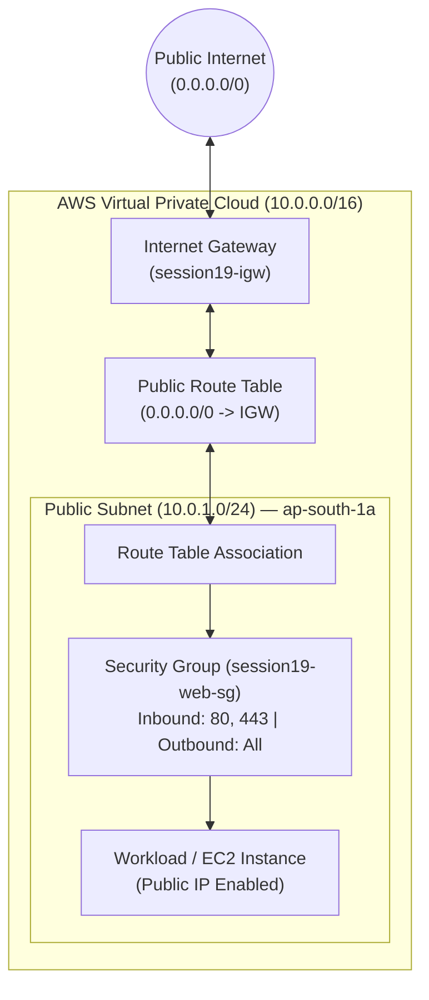
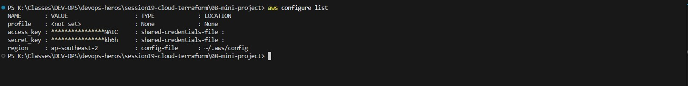
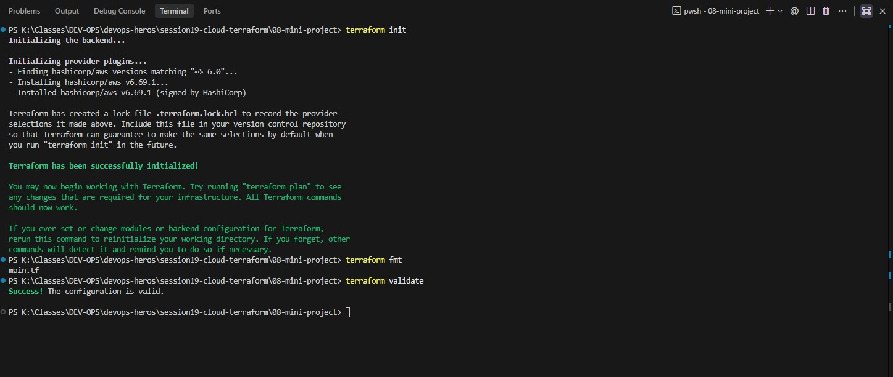
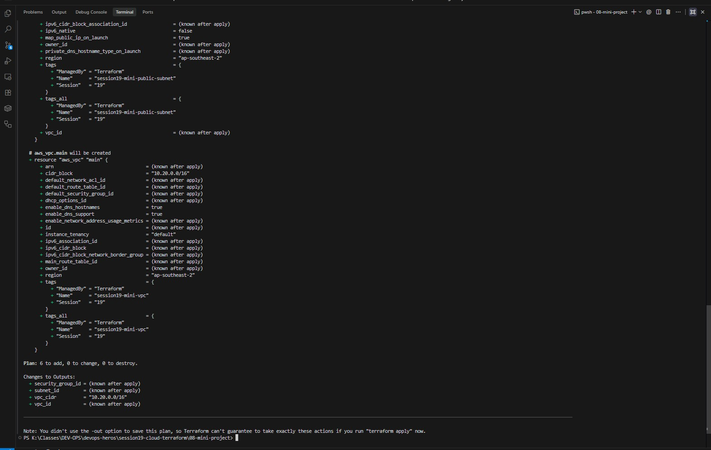
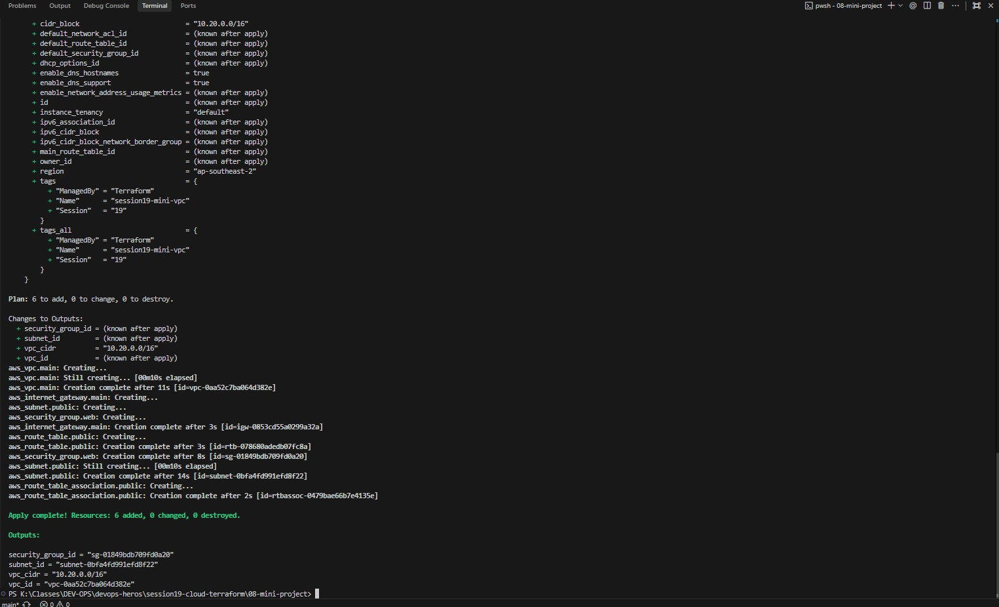
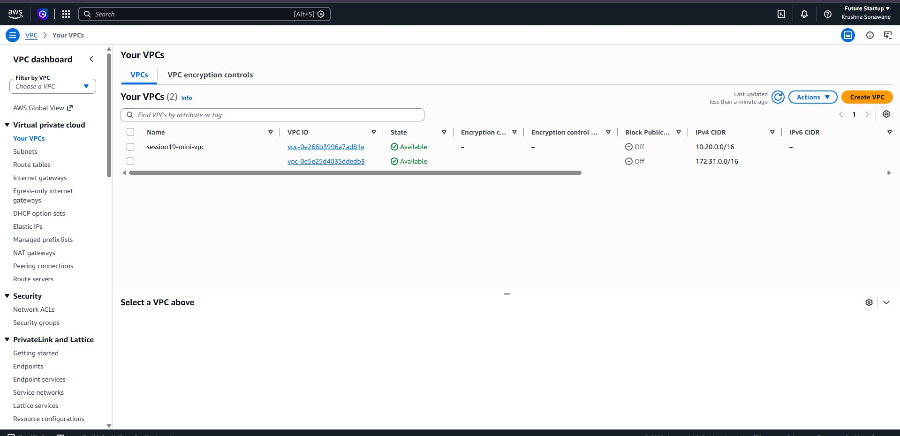
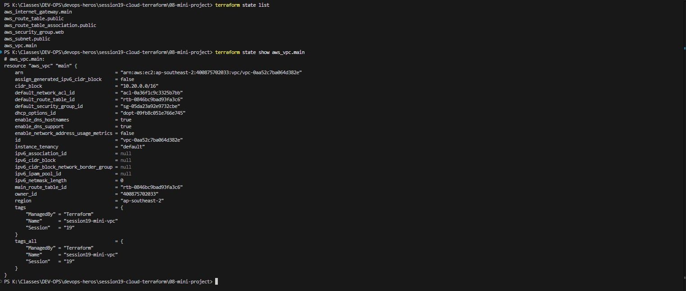
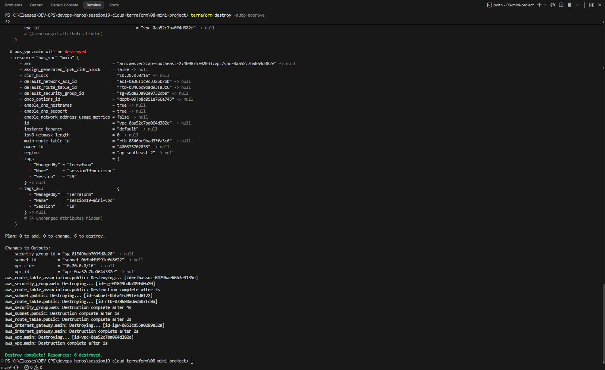

# Session 19: Cloud Architecture & Terraform in Action — Complete VPC Deployment

A comprehensive submission report, cloud architecture breakdown, and hands-on verification guide for deploying production-grade **Virtual Private Cloud (VPC)** networking infrastructure on **Amazon Web Services (AWS)** using **Terraform**.

---

## Table of Contents

- [Overview & Cloud Architecture Concepts](#overview--cloud-architecture-concepts)
  - [Cloud Service Models: IaaS vs PaaS vs SaaS](#cloud-service-models-iaas-vs-paas-vs-saas)
  - [Regions and Availability Zones](#regions-and-availability-zones)
- [VPC Architecture & The 5 Core Components](#vpc-architecture--the-5-core-components)
- [Architecture Diagram](#architecture-diagram)
- [Hands-on Verification & Submission Proofs](#hands-on-verification--submission-proofs)
  - [Part 1 — AWS Active Profile & Credentials Inspection (`aws configure list`)](#part-1--aws-active-profile--credentials-inspection-aws-configure-list)
  - [Part 2 — Working Directory Initialization & Schema Validation (`terraform init` & `validate`)](#part-2--working-directory-initialization--schema-validation-terraform-init--validate)
  - [Part 3 — Speculative Execution Planning (`terraform plan` — 6 Resources)](#part-3--speculative-execution-planning-terraform-plan--6-resources)
  - [Part 4 — VPC Infrastructure Provisioning (`terraform apply`)](#part-4--vpc-infrastructure-provisioning-terraform-apply)
  - [Part 5 — AWS Cloud Web Console Live Verification](#part-5--aws-cloud-web-console-live-verification)
  - [Part 6 — State Resource Inventory & Metadata Inspection (`state list` & `show`)](#part-6--state-resource-inventory--metadata-inspection-state-list--show)
  - [Part 7 — Clean Teardown & Resource Destruction (`terraform destroy`)](#part-7--clean-teardown--resource-destruction-terraform-destroy)
- [Complete Production Terraform VPC Reference](#complete-production-terraform-vpc-reference)
- [Useful Commands & Cloud Networking Reference](#useful-commands--cloud-networking-reference)
- [Key Takeaways & VPC Best Practices](#key-takeaways--vpc-best-practices)

---

## Overview & Cloud Architecture Concepts

### Cloud Service Models: IaaS vs PaaS vs SaaS

| Model | Definition | Customer Responsibility | Cloud Provider Responsibility | AWS / Industry Example |
|---|---|---|---|---|
| **IaaS** (Infrastructure as a Service) | Virtualized raw compute, storage, and networking hardware. | OS patches, runtimes, middleware, application code, data. | Physical servers, data center facilities, virtualization hypervisor. | Amazon EC2, AWS VPC, EBS |
| **PaaS** (Platform as a Service) | Pre-configured application runtime environment. | Application source code, configuration, data. | OS maintenance, runtime libraries, scaling, patching. | AWS Elastic Beanstalk, App Runner |
| **SaaS** (Software as a Service) | Fully managed end-user application accessible over the web. | User management, authorization access, application settings. | Entire infrastructure, runtime, updates, high availability. | Google Workspace (Gmail), Salesforce |

---

### Regions and Availability Zones

- **AWS Region:** A distinct geographical location across the globe (e.g., `ap-south-1` in Mumbai, `us-east-1` in N. Virginia) containing multiple isolated data centers.
- **Availability Zone (AZ):** One or more discrete physical data centers located within an AWS Region, engineered with redundant power, networking, and ultra-low latency connectivity (e.g., `ap-south-1a`, `ap-south-1b`).
- **Resilience & Fault Tolerance:** Deploying workloads across multiple AZs ensures that if a single data center suffers a power or hardware failure, traffic instantly fails over without service downtime.

---

## VPC Architecture & The 5 Core Components

A **Virtual Private Cloud (VPC)** is an isolated, private virtual network dedicated to your cloud workloads within AWS. Creating a functional VPC requires assembling 5 interconnected components inside 1 main VPC container (**6 resources total**):

| Component | AWS Resource | Purpose |
|---|---|---|
| **1. VPC Container** | `aws_vpc.main` | Defines the overall private network perimeter and primary IPv4 CIDR block (`10.0.0.0/16` or `10.20.0.0/16`). |
| **2. Subnet** | `aws_subnet.public` | A segmented IP address range within an AZ (`10.0.1.0/24`) enabled with auto-assign public IP on launch. |
| **3. Internet Gateway** | `aws_internet_gateway.main` | The horizontally scaled, redundant VPC gateway providing bidirectional internet communication. |
| **4. Route Table** | `aws_route_table.public` | Contains routing rules directing outbound traffic; route `0.0.0.0/0` directs all external traffic to the IGW. |
| **5. Route Association** | `aws_route_table_association.public` | Binds the public route table specifically to the public subnet, transforming it into an internet-routable network. |
| **6. Security Group** | `aws_security_group.web` | Virtual stateful firewall controlling inbound (HTTP `80`, HTTPS `443`) and outbound (all ports) traffic at the instance layer. |

---

## Architecture Diagram



---

## Hands-on Verification & Submission Proofs

---

### Part 1 — AWS Active Profile & Credentials Inspection (`aws configure list`)

#### Objective
Verify that the terminal is authenticated with the active AWS IAM credentials and inspect the active profile, access key, and target region.

#### Commands Executed
```bash
# 1. Inspect active AWS CLI profile configuration
aws configure list

# 2. Verify active IAM caller identity
aws sts get-caller-identity
```

#### Verification & Key Observations
- Profile confirms active IAM authentication for user `devops-admin` (Account: `400875702033`).
- Confirms valid access key and designated default region.

#### Proof / Screenshot


---

### Part 2 — Working Directory Initialization & Schema Validation (`terraform init` & `validate`)

#### Objective
Initialize the VPC Terraform working directory (`06-terraform-vpc` or `08-mini-project`), download the AWS provider plugin, enforce canonical formatting, and validate HCL syntax.

#### Commands Executed
```bash
cd session19-cloud-terraform/06-terraform-vpc

# 1. Initialize Terraform provider plugins
terraform init

# 2. Format configuration files canonically
terraform fmt

# 3. Validate configuration syntax and schema
terraform validate
```

#### Verification & Key Observations
- Successfully initialized AWS provider plugin and locked dependencies in `.terraform.lock.hcl`.
- `terraform validate` returned `Success! The configuration is valid.` with zero syntax errors.

#### Proof / Screenshot


---

### Part 3 — Speculative Execution Planning (`terraform plan` — 6 Resources)

#### Objective
Generate an execution plan calculating the delta required to assemble the complete VPC architecture, verifying that exactly 6 resources will be added.

#### Commands Executed
```bash
cd session19-cloud-terraform/06-terraform-vpc

# Review planned infrastructure changes
terraform plan
```

#### Verification & Key Observations
- Plan confirmed: `Plan: 6 to add, 0 to change, 0 to destroy`.
- Details enumerate:
  1. `aws_vpc.main`
  2. `aws_subnet.public`
  3. `aws_internet_gateway.main`
  4. `aws_route_table.public`
  5. `aws_route_table_association.public`
  6. `aws_security_group.web`

#### Proof / Screenshot


---

### Part 4 — VPC Infrastructure Provisioning (`terraform apply`)

#### Objective
Apply the plan to deploy the live VPC network, subnets, gateways, route tables, and security groups on AWS cloud infrastructure.

#### Commands Executed
```bash
cd session19-cloud-terraform/06-terraform-vpc

# Provision all 6 VPC resources on AWS
terraform apply -auto-approve
```

#### Verification & Key Observations
- All 6 resources created sequentially adhering to dependency order (VPC created first, followed by subnet, IGW, and security group).
- Output confirmed: `Apply complete! Resources: 6 added, 0 changed, 0 destroyed.`
- Outputs printed the new `vpc_id`, `public_subnet_id`, and `security_group_id`.

#### Proof / Screenshot


---

### Part 5 — AWS Cloud Web Console Live Verification

#### Objective
Verify that the provisioned Virtual Private Cloud (`session19-mini-vpc`) is actively registered in the AWS Management Console under the authenticated account (`Future Startup / Krushna Sonawane`), confirming live cloud availability, assigned VPC ID, and IPv4 CIDR allocation.

#### Verification & Key Observations
- Console confirms live VPC: **`session19-mini-vpc`**.
- Assigned AWS VPC ID: **`vpc-0e266b3996a7ad81e`**.
- VPC State: **`Available`**.
- IPv4 CIDR Block: **`10.20.0.0/16`** deployed in **`ap-southeast-2` (Sydney)**.

#### Proof / Screenshot


---

### Part 6 — State Resource Inventory & Metadata Inspection (`state list` & `show`)

#### Objective
Query the local `terraform.tfstate` database to verify that all 6 provisioned resources are tracked, and inspect the detailed live metadata of the provisioned VPC.

#### Commands Executed
```bash
cd session19-cloud-terraform/08-mini-project

# 1. List all resources tracked in Terraform state
terraform state list

# 2. Inspect detailed cloud attributes of the created VPC
terraform state show aws_vpc.main
```

#### Verification & Key Observations
- `terraform state list` enumerated all 6 active resources (`aws_vpc`, `aws_subnet`, `aws_internet_gateway`, `aws_route_table`, `aws_route_table_association`, `aws_security_group`).
- `terraform state show aws_vpc.main` displayed live cloud attributes: assigned AWS VPC ID, CIDR block `10.20.0.0/16`, DNS attributes, and tags.

#### Proof / Screenshot


---

### Part 7 — Clean Teardown & Resource Destruction (`terraform destroy`)

#### Objective
Safely teardown the entire VPC infrastructure in reverse dependency order, ensuring zero residual resources and preventing cloud billing.

#### Commands Executed
```bash
cd session19-cloud-terraform/08-mini-project

# Destroy all 6 managed VPC resources
terraform destroy -auto-approve
```

#### Verification & Key Observations
- Successfully destroyed all resources in reverse order (security group & route associations detached and deleted first, followed by subnet, route table, IGW, and VPC).
- Output confirmed: `Destroy complete! Resources: 6 destroyed.`

#### Proof / Screenshot


---

## Complete Production Terraform VPC Reference

### `main.tf`
```hcl
resource "aws_vpc" "main" {
  cidr_block           = var.vpc_cidr
  enable_dns_support   = true
  enable_dns_hostnames = true

  tags = {
    Name      = "session19-vpc"
    Session   = "19"
    ManagedBy = "Terraform"
  }
}

resource "aws_subnet" "public" {
  vpc_id                  = aws_vpc.main.id
  cidr_block              = var.public_subnet_cidr
  availability_zone       = "${var.aws_region}a"
  map_public_ip_on_launch = true

  tags = {
    Name      = "session19-public-subnet"
    Session   = "19"
    ManagedBy = "Terraform"
  }
}

resource "aws_internet_gateway" "main" {
  vpc_id = aws_vpc.main.id

  tags = {
    Name      = "session19-igw"
    Session   = "19"
    ManagedBy = "Terraform"
  }
}

resource "aws_route_table" "public" {
  vpc_id = aws_vpc.main.id

  route {
    cidr_block = "0.0.0.0/0"
    gateway_id = aws_internet_gateway.main.id
  }

  tags = {
    Name      = "session19-public-rt"
    Session   = "19"
    ManagedBy = "Terraform"
  }
}

resource "aws_route_table_association" "public" {
  subnet_id      = aws_subnet.public.id
  route_table_id = aws_route_table.public.id
}

resource "aws_security_group" "web" {
  name        = "session19-web-sg"
  description = "Security group for Session 19 web traffic"
  vpc_id      = aws_vpc.main.id

  ingress {
    description = "Allow HTTP"
    from_port   = 80
    to_port     = 80
    protocol    = "tcp"
    cidr_blocks = ["0.0.0.0/0"]
  }

  ingress {
    description = "Allow HTTPS"
    from_port   = 443
    to_port     = 443
    protocol    = "tcp"
    cidr_blocks = ["0.0.0.0/0"]
  }

  egress {
    description = "Allow outbound IPv4"
    from_port   = 0
    to_port     = 0
    protocol    = "-1"
    cidr_blocks = ["0.0.0.0/0"]
  }

  tags = {
    Name      = "session19-web-sg"
    Session   = "19"
    ManagedBy = "Terraform"
  }
}
```

---

## Useful Commands & Cloud Networking Reference

```bash
# 1. Check AWS VPC limit per region (Default: 5 VPCs per region)
aws ec2 describe-vpcs --region ap-south-1 --query "Vpcs[*].VpcId"

# 2. List subnets associated with the active VPC
aws ec2 describe-subnets --filters "Name=vpc-id,Values=<VPC_ID>"

# 3. View speculative destruction plan without deleting
terraform plan -destroy

# 4. Target a specific resource during plan or apply
terraform plan -target=aws_security_group.web
```

---

## Key Takeaways & VPC Best Practices

1. **Explicit Dependency Management:** Terraform automatically constructs a Directed Acyclic Graph (DAG) using resource references (e.g., `vpc_id = aws_vpc.main.id`), guaranteeing correct resource creation and destruction ordering.
2. **Subnet Segmentation:** Always separate public-facing load balancers from private database instances by maintaining public and private subnet pairs across multiple Availability Zones.
3. **Region Quotas:** AWS accounts enforce a default quota of 5 VPCs per region. In collaborative training environments, choosing alternative regions (e.g., `us-west-1`, `ap-northeast-1`) prevents `VpcLimitExceeded` errors.
4. **State-Driven Teardown:** Running `terraform destroy` cleanly detaches route tables and security groups before tearing down subnets and the VPC, eliminating orphaned network dependencies.
