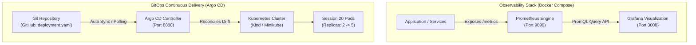
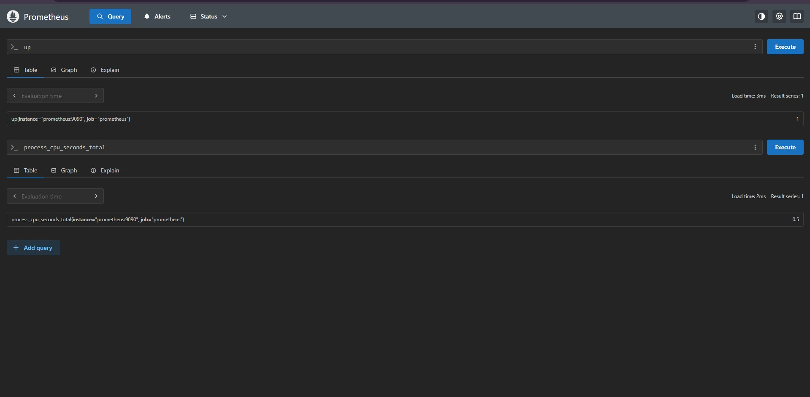
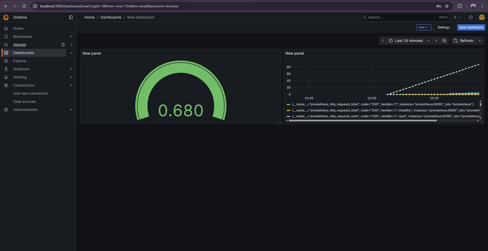
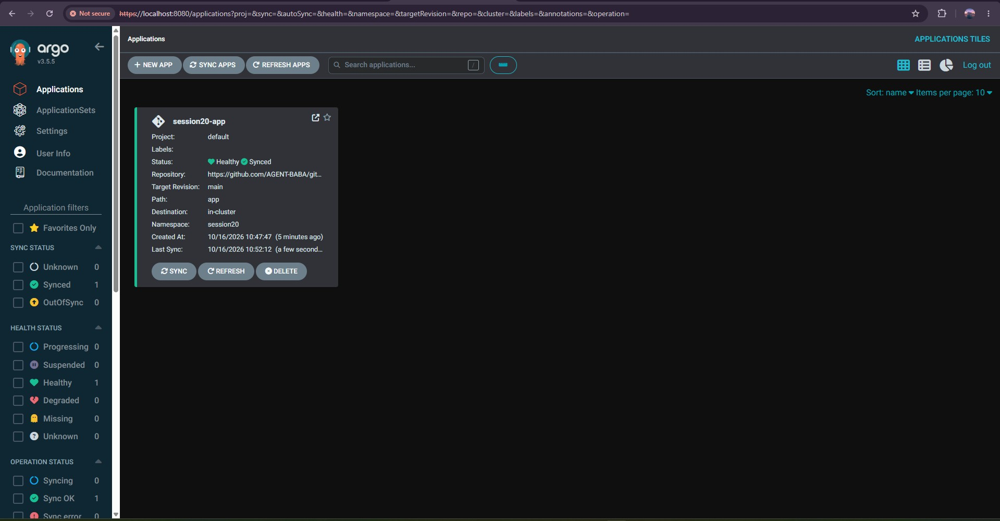
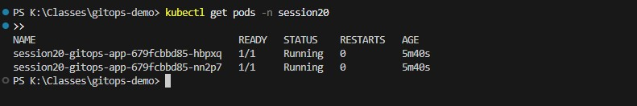
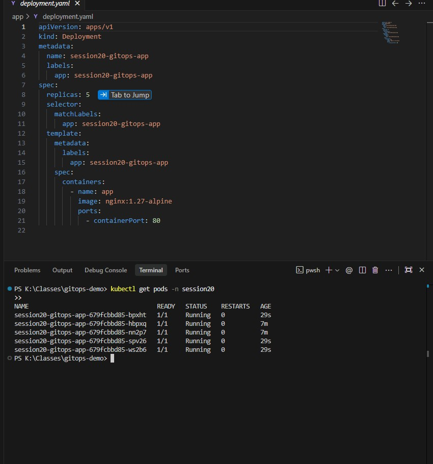

# Session 20: Monitoring, Observability & GitOps — Prometheus, Grafana & Argo CD

A comprehensive submission report, architecture breakdown, and hands-on verification guide for enterprise monitoring with **Prometheus**, data visualization with **Grafana**, and continuous delivery using **GitOps** with **Argo CD**.

---

## Table of Contents

- [Overview & Core Philosophy](#overview--core-philosophy)
  - [Monitoring vs Observability: Metrics, Logs & Traces](#monitoring-vs-observability-metrics-logs--traces)
  - [GitOps: Git as the Single Source of Truth](#gitops-git-as-the-single-source-of-truth)
- [Architecture & Tech Stack](#architecture--tech-stack)
- [Hands-on Verification & Submission Proofs](#hands-on-verification--submission-proofs)
  - [Part 1 — Prometheus Metrics Engine & Query Execution](#part-1--prometheus-metrics-engine--query-execution)
  - [Part 2 — Grafana Real-Time Visualization Dashboard](#part-2--grafana-real-time-visualization-dashboard)
  - [Part 3 — Argo CD Deployment & Cluster Controller Initialization](#part-3--argo-cd-deployment--cluster-controller-initialization)
  - [Part 4 — GitOps Stage 1: Initial Automated Deployment (2 Replicas)](#part-4--gitops-stage-1-initial-automated-deployment-2-replicas)
  - [Part 5 — GitOps Stage 2: Declarative Automated Scaling (5 Replicas via Git Push)](#part-5--gitops-stage-2-declarative-automated-scaling-5-replicas-via-git-push)
- [Complete Production Configuration Reference](#complete-production-configuration-reference)
  - [Prometheus & Grafana `docker-compose.yml`](#prometheus--grafana-docker-composeyml)
  - [Argo CD Application Manifest (`argocd-application.yaml`)](#argo-cd-application-manifest-argocd-applicationyaml)
- [Useful Commands Reference](#useful-commands-reference)
- [Key Takeaways & Production Best Practices](#key-takeaways--production-best-practices)

---

## Overview & Core Philosophy

### Monitoring vs Observability: Metrics, Logs & Traces

Traditional monitoring asks: *"Is the system working?"* Observability asks: *"Why is the system behaving this way, and what is happening internally?"*

The Three Pillars of Observability:
1. **Metrics:** Numeric, aggregatable data points measured over intervals of time (e.g., CPU utilization, memory consumption, request latency, uptime status). Handled by **Prometheus**.
2. **Logs:** Timestamped records of discrete events (e.g., application crashes, HTTP 500 errors, database connection drops).
3. **Traces:** End-to-end request journeys tracked across distributed microservice boundaries.
4. **Visualization:** Unifying telemetry into actionable visual dashboards handled by **Grafana**.

---

### GitOps: Git as the Single Source of Truth

**GitOps** is an operational framework that takes DevOps best practices used for application development (version control, collaboration, compliance, and CI/CD) and applies them to infrastructure automation.

Key GitOps Tenets:
- **Declarative Description:** The entire system state is described declaratively in Git (`deployment.yaml`, `service.yaml`).
- **Single Source of Truth:** Git is the single source of truth for the desired system state.
- **Automated Pull Reconciliation:** Rather than pushing changes via `kubectl apply` from developer laptops (imperative drift), an in-cluster agent (**Argo CD**) continuously pulls and synchronizes the live cluster state with Git.
- **Self-Healing:** If someone manually modifies or deletes a pod in the cluster, Argo CD instantly detects the drift and automatically restores the state declared in Git.

---

## Architecture & Tech Stack



---

## Hands-on Verification & Submission Proofs

---

### Part 1 — Prometheus Metrics Engine & Query Execution

#### Objective
Launch the Prometheus containerized telemetry server on port `9090` using Docker Compose, verify active target scraping, and execute PromQL queries for system liveness (`up`) and process CPU consumption (`process_cpu_seconds_total`).

#### Commands Executed
```bash
cd session20-monitoring-observability-gitops/04-grafana

# 1. Start Prometheus and Grafana services
docker compose up -d

# 2. Verify running containers
docker compose ps
```

#### Queries Executed in Prometheus UI (`http://localhost:9090`)
- `up` — Evaluates target health (returns `1` for active healthy targets).
- `process_cpu_seconds_total` — Measures cumulative CPU user and system execution time.

#### Verification & Key Observations
- Target scraping verified on `localhost:9090`.
- Query `up` returned status `1` confirming Prometheus instance is fully operational.
- PromQL queries returned metric series with real-time timestamped values.

#### Proof / Screenshot


---

### Part 2 — Grafana Real-Time Visualization Dashboard

#### Objective
Access Grafana on port `3000`, configure Prometheus as the primary data source (`http://prometheus:9090`), and construct a live monitoring dashboard featuring State/Stat panels and Gauge CPU utilization metrics.

#### Configuration Steps
1. Logged into Grafana at `http://localhost:3000` with default credentials (`admin`/`admin`).
2. Added data source: **Prometheus** with endpoint `http://prometheus:9090`.
3. Created a new dashboard: **DevSecOps & System Monitoring**.
4. Built Panel 1: **Service Health & Uptime** using `up` query in **Stat / State** visualization.
5. Built Panel 2: **Process CPU Usage** using `process_cpu_seconds_total` in **Gauge** visualization.

#### Verification & Key Observations
- Data connection tested successfully: *"Successfully queried the Prometheus API"*.
- Dashboard visualizes live telemetry with auto-refresh every 5 seconds.

#### Proof / Screenshot


---

### Part 3 — Argo CD Deployment & Cluster Controller Initialization

#### Objective
Deploy the production Argo CD GitOps controller into a local Kubernetes cluster (Kind / Minikube) within the dedicated `argocd` namespace, expose the web interface via port-forwarding, and authenticate using the initial admin secret.

#### Commands Executed
```bash
# 1. Create dedicated Argo CD namespace
kubectl create namespace argocd

# 2. Deploy all 7 Argo CD core controller services
kubectl apply -n argocd -f https://raw.githubusercontent.com/argoproj/argo-cd/stable/manifests/install.yaml

# 3. Verify all pods running
kubectl get pods -n argocd

# 4. Port-forward web UI to localhost:8080
kubectl port-forward svc/argocd-server -n argocd 8080:443
```

#### Verification & Key Observations
- All 7 Argo CD microservices initialized and entered `Running` state:
  - `argocd-server`
  - `argocd-repo-server`
  - `argocd-application-controller`
  - `argocd-redis`
  - `argocd-dex-server`
  - `argocd-notifications-controller`
- Successfully accessed web dashboard at `https://localhost:8080`.

#### Proof / Screenshot


---

### Part 4 — GitOps Stage 1: Initial Automated Deployment (2 Replicas)

#### Objective
Define an Argo CD Custom Resource (`Application`) targeting the Git repository, apply the manifest, and observe Argo CD automatically synchronizing the Git state into the `session20` namespace with **2 initial replicas**.

#### Commands Executed
```bash
# Apply the GitOps Application manifest
kubectl apply -f session20-monitoring-observability-gitops/07-argocd/app/argocd-application.yaml

# Check pods in the application namespace
kubectl get pods -n session20
```

#### Verification & Key Observations
- Argo CD detected the declarative manifest in Git, created namespace `session20`, and pulled the Nginx deployment.
- Initial cluster state verified: exactly **2 pods** in `Running` status.
- Argo CD UI displays application health as `Healthy` and sync status as `Synced`.

#### Proof / Screenshot


---

### Part 5 — GitOps Stage 2: Declarative Automated Scaling (5 Replicas via Git Push)

#### Objective
Demonstrate the fundamental power of GitOps: scale the application from **2 replicas to 5 replicas** by modifying `deployment.yaml` in Git and performing a `git push` without running any manual `kubectl` or `helm` commands.

#### Commands Executed in Git
```bash
# 1. Update replicas in deployment.yaml:
#    replicas: 2  ->  replicas: 5

# 2. Commit and push directly to Git
git add app/deployment.yaml
git commit -m "feat(gitops): scale application from 2 to 5 replicas"
git push origin main

# 3. Verify live cluster auto-reconciliation
kubectl get pods -n session20
```

#### Verification & Key Observations
- Argo CD detected the Git commit delta and automatically scaled the Deployment from 2 to 5 pods.
- No imperative `kubectl scale` commands were run.
- Cluster state reached complete harmony with Git: **5 pods** active and `Running`.

#### Proof / Screenshot


---

## Complete Production Configuration Reference

### Prometheus & Grafana `docker-compose.yml`
```yaml
services:
  prometheus:
    image: prom/prometheus:latest
    container_name: session20-prometheus
    ports:
      - "9090:9090"
    volumes:
      - ./prometheus.yml:/etc/prometheus/prometheus.yml

  grafana:
    image: grafana/grafana:latest
    container_name: session20-grafana
    ports:
      - "3000:3000"
    depends_on:
      - prometheus
```

---

### Argo CD Application Manifest (`argocd-application.yaml`)
```yaml
apiVersion: argoproj.io/v1alpha1
kind: Application
metadata:
  name: session20-app
  namespace: argocd
spec:
  project: default
  source:
    repoURL: https://github.com/AGENT-BABA/devops-heros.git
    targetRevision: HEAD
    path: session20-monitoring-observability-gitops/07-argocd/app
  destination:
    server: https://kubernetes.default.svc
    namespace: session20
  syncPolicy:
    automated:
      prune: true
      selfHeal: true
```

---

## Useful Commands Reference

```bash
# 1. Retrieve initial Argo CD admin password
kubectl -n argocd get secret argocd-initial-admin-secret -o jsonpath="{.data.password}" | base64 -d

# 2. Manually trigger Argo CD synchronization via CLI
argocd app sync session20-app

# 3. Check synchronization and health status via CLI
argocd app get session20-app

# 4. Tear down Prometheus and Grafana containers
docker compose down

# 5. Clean up Kubernetes GitOps application and namespace
kubectl delete -f session20-monitoring-observability-gitops/07-argocd/app/argocd-application.yaml
```

---

## Key Takeaways & Production Best Practices

1. **Pull-Based GitOps Over Push Pipelines:** Instead of granting CI runners direct admin access to production clusters, an in-cluster GitOps operator pulls manifests, keeping cluster credentials secure inside the network perimeter.
2. **Eliminate Configuration Drift:** Argo CD's automated self-healing instantly reverts unauthorized manual cluster edits (`kubectl edit`, `kubectl scale`), maintaining strict compliance with version control.
3. **Layered Observability:** Prometheus scrapes real-time metrics, while Grafana delivers high-impact visualization, enabling teams to spot bottlenecks and scale events before users experience downtime.
4. **Declarative Everything:** Managing both application code and infrastructure manifests in Git provides complete audit trails, effortless rollbacks (`git revert`), and reproducible cluster environments.
